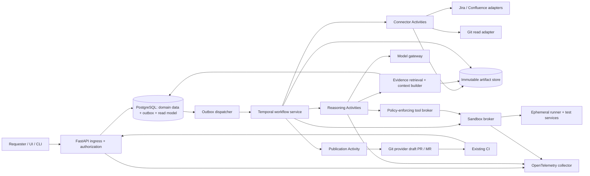

# High-level design (HLD)

Version 1.0 — 28 October 2026.

Research checked: **2026-10-28**. The architecture below is a proposed engineering design, not a claim that the named tools provide the complete product. Use current supported releases at implementation time, validate compatibility, and commit exact dependency lockfiles and image digests. Do not use floating `latest` production images or hard-code an unverified model/version recommendation.

## 1. Architecture decisions

1. Build a modular Python service with a framework-independent domain model. Target repositories may use any language; runner images and verified framework adapters provide the target runtime.
2. Use **Temporal as the single durable workflow authority**. Keep network I/O, model inference, database access, Git operations, and sandbox operations in Activities. Workflow code contains deterministic state transitions and policy decisions. Do not require LangGraph, Celery, Kafka, or a second workflow state machine for the initial implementation.
3. Expose a versioned **FastAPI + Pydantic** API. These tools provide typed validation and OpenAPI/JSON Schema integration; project-specific authorization and semantic validation must still be implemented. [FastAPI features](https://fastapi.tiangolo.com/features/)
4. Use **PostgreSQL** for requests, project configuration, requirement/scenario metadata, evidence references, publication records, audit entries, and a UI read model. Use an **S3-compatible object store** for immutable snapshots, patches, reports, and large logs. Temporal stores orchestration history; Postgres does not independently decide workflow transitions.
5. Start retrieval with exact repository search, document full-text search, and syntax-aware indexing. Add **pgvector** only when the evaluation demonstrates a retrieval benefit. pgvector supports vector similarity and can be combined with PostgreSQL full-text search; fusion and reranking are application behavior. [pgvector README](https://github.com/pgvector/pgvector)
6. Run target code and generated tests in an isolated **execution plane**, separate from connector, model, database, and publication credentials. A broker enforces validated tool contracts and execution policy.
7. Publish through a provider adapter into the existing Git and CI workflow. The default publication is a draft pull/merge request with evidence; merge policy remains with the repository owner.
8. Use **OpenTelemetry** for cross-service traces, metrics, and logs, exported to the organization's existing monitoring backend. It is instrumentation, not a replacement for a storage/dashboard backend. [OpenTelemetry observability primer](https://opentelemetry.io/docs/concepts/observability-primer/)

## 2. System context and component diagram



The diagram represents logical components. For the pilot, implement the API, connectors, retrieval, domain services, and publication adapters as modules of one codebase, with separate worker processes for independent security and scaling needs. Do not begin with independently deployed microservices for every box.

## 3. Responsibilities and interfaces

| Component | Responsibility | Important boundary |
|---|---|---|
| API / CLI | Authenticate requester; authorize source and target access; validate job; accept idempotency key; query status; submit explicit decisions/cancellation | Does not execute repository code or run long background jobs in the API process |
| Project configuration | Allowed repositories, source field mappings, precedence policy, trusted runner profiles, credential references, publication policy | References secrets; never embeds secret values in model context |
| Temporal workflow | Ordered stages, checkpoints, decision waits, budgets, retries, cancellation, compensation, final outcome | External I/O occurs in Activities |
| Connector workers | Permission-scoped source fetch, pagination, normalization, snapshot manifests, incremental refresh | Source text is evidence, not executable instruction |
| Repository profiler | Identify modules, framework versions, tests, fixtures, build/config/CI commands, test discovery; create candidate execution profile | Execution profile is policy-validated and probed before use |
| Retrieval service | Tenant/ACL-filtered exact, lexical, symbol and optional semantic retrieval; deduplicate; build cited context bundles | All reads tied to a snapshot manifest; no cross-tenant cache |
| Reasoning worker | Normalize requirements, plan scenarios, propose patches, classify failures, produce review findings | Typed outputs validated; bounded tool calls; cannot grant itself permissions |
| Model gateway | Provider abstraction, model routing, token budgets, timeouts, request metadata, output schema handling | No autonomous shell/Git privileges; model upgrades evaluated before rollout |
| Sandbox broker | Create runners, inject narrowly scoped environment access, execute approved argv commands, enforce quotas, collect reports, destroy resources | Control-plane secrets and host Docker socket unavailable to tested code |
| Artifact service | Content hashes, signed/authorized access, manifests, retention, lifecycle cleanup | Object-store metadata cannot bypass API authorization |
| Git publication adapter | Check base revision, commit allowed diff, create/update draft PR/MR idempotently, record provider IDs | No direct default-branch push, merge, or force-push by default |
| Evaluation service | Run versioned benchmark corpus; calculate correctness, coverage, defect sensitivity, maintainability, cost | Benchmark ground truth independent of generated output |
| Audit / observability | Who accessed what, policy decisions, tool execution outcomes, workflow correlations | Raw prompts/code/logs subject to redaction and retention rules |

## 4. Recommended technology matrix

| Concern | Initial selection | When to extend / substitute |
|---|---|---|
| Language / packaging | Supported Python release; `uv` or organization-standard package manager; committed lockfile | TypeScript is also viable if the implementation team is stronger in it; keep schemas/interfaces equivalent |
| API / validation | FastAPI, Pydantic; SQLAlchemy and Alembic for persistence/migrations | Existing organization framework takes precedence if compatible |
| Durable orchestration | Temporal Python SDK + managed or self-hosted Temporal service | Alternative durable engine only through a documented architecture decision |
| Domain metadata | PostgreSQL | Partition/archive based on measured volume; avoid premature distributed databases |
| Artifacts | Existing cloud object storage with S3-style interface, encryption and lifecycle rules | Local filesystem artifact adapter for offline development only |
| Exact retrieval | `rg`, Git file listing, bounded file reads | IDE/language-server symbol resolution as needed |
| Syntax retrieval | Tree-sitter per supported grammar; language tooling where higher semantic accuracy is needed | Dependency/service graph when multi-repository impact analysis warrants it |
| Lexical retrieval | PostgreSQL `tsvector`, GIN, `ts_rank_cd` | Search service such as OpenSearch if measured scale/relevance requires it |
| Semantic retrieval | Optional pgvector; embedding provider abstraction | Dedicated vector database only after an explicit benchmark or operational need |
| Hybrid ranking | Application-side reciprocal-rank fusion; optional reranker; exact symbol boosts | Calibrate using a labeled retrieval corpus, not self-assessed relevance |
| Target execution | OCI runner images plus container execution for trusted local pilot; stronger isolation for production untrusted workloads | gVisor or microVM platform selected after OS, browser, native dependency and nested-container compatibility tests |
| Git / CI | Provider REST API and Git subprocess through adapters; reuse existing CI | GitHub, GitLab, Bitbucket, Azure DevOps adapters implemented incrementally |
| Service authentication | OIDC for users; short-lived workload identities; existing secret manager | Enterprise federation and customer-managed encryption as needed |
| Telemetry | OpenTelemetry SDK/collector; existing metrics, traces and log backend | LLM evaluation dashboard optional, with code/privacy configuration checked |
| Dev environment | Docker Compose or equivalent: API, worker, Temporal, Postgres, local artifact service | Kubernetes optional when production scaling/operations already justify it |

PostgreSQL's built-in full-text rankers are `ts_rank` and `ts_rank_cd`; **do not label native `tsvector` ranking as BM25**. GIN is the documented preferred text-search index type. [Text search ranking](https://www.postgresql.org/docs/16/textsearch-controls.html), [Text-search indexes](https://www.postgresql.org/docs/16/textsearch-indexes.html)

## 5. Ingestion, source boundaries, and traceability

Implement `JiraCloudConnector` and `ConfluenceCloudConnector` first. Data Center is a phased/configured-deployment extension requiring distinct adapters. Do not route Cloud and Data Center through one assumed URL/auth/pagination implementation. The target product, deployment kind, base URL, and supported server version must be explicit project configuration.

For Jira Cloud use the documented REST v3 APIs; supported authorization and data representations depend on integration type. Configure acceptance-criteria extraction by tenant/project field mapping: it may be a custom field, part of the description, or an external linked document. Store raw and normalized forms and preserve ADF structure where applicable. [Jira Cloud REST v3](https://developer.atlassian.com/cloud/jira/platform/rest/v3/)

For Confluence Cloud, REST v2 supports cursor pagination; page APIs expose page body and version information and enforce page/space permissions. Capture page ID, version, body format, section anchor, retrieval time and content hash. Follow explicitly relevant links within configured bounds; support approved attachments through extraction adapters. Record unsupported macros or inaccessible attachments as gaps. [Confluence v2](https://developer.atlassian.com/cloud/confluence/rest/v2/), [Page API](https://developer.atlassian.com/cloud/confluence/rest/v2/api-group-page)

Data Center uses its own product/version-specific API documentation and authorization configuration. Implement and contract-test against the actual customer deployment; do not infer API compatibility from Cloud. [Jira Data Center API](https://developer.atlassian.com/server/jira/platform/rest/v10006/), [Confluence Data Center API](https://developer.atlassian.com/server/confluence/rest/latest/)

All connectors must honor `Retry-After`, use bounded backoff with jitter, page responses, and limit requested fields. Jira Cloud rate limiting has multiple mechanisms and current documentation distinguishes integration types; do not encode a presumed universal requests-per-minute quota. [Jira Cloud rate limits](https://developer.atlassian.com/cloud/jira/platform/rate-limiting/)

Each generation freezes a `SourceSnapshotManifest`. The block below is a conceptual source-plus-execution view; persist source facts separately from the derived ExecutionManifest as defined in LLD section 13:

```text
tenant_id, project_id, snapshot_id, captured_at, manifest_hash
sources[]:
  kind, provider, resource_id, canonical_url
  version_or_revision, source_updated_at, retrieved_at
  normalized_content_hash, raw_artifact_ref
  principal_scope_ref, permission_checked_at
repositories[]:
  repository_id, role(application|automation|contract), commit_sha
  submodule_and_lfs_refs, lockfile_hashes
test_environment:
  image_digests, application_build_ids, service_versions
```

Jira `updated` timestamps plus captured content hashes establish the ingested snapshot; they do not imply a transactional version shared with Confluence or Git. Before publishing, check relevant source and base-branch changes. If changes affect the plan, create a new snapshot and replan/revalidate. Preserve the old attempt for audit. Permission revocation must stop future retrieval and restrict access to stored derived artifacts according to retention policy.

## 6. Retrieval design

1. Apply tenant, project, source ACL and snapshot filters **before** candidate content reaches the model.
2. Search exact requirement identifiers, endpoints, public symbols and paths first.
3. Retrieve lexical matches and optional semantic matches in parallel; merge ranks and remove duplicate chunks.
4. Expand selected code units to required imports, fixture definitions, base classes and relevant call sites. Keep bounded file/repository budgets.
5. Include authoritative requirement spans, application contracts, representative existing tests and verified test commands in each scenario context bundle.
6. Record candidate IDs, chosen evidence, retrieval configuration version and exclusion reasons. Provide evidence references, not just text.

Chunk documents by sections/acceptance criteria and code by syntax units, with file and line anchors at pinned commits. Contextual summaries and embeddings are derivative indexes, never authoritative source replacements. Cache keys include tenant/principal scope, source hash, parser/chunker version and embedding model revision. A cache hit cannot extend previously granted access.

## 7. Durable execution, consistency, and recovery

Temporal workflows must remain deterministic; external calls and model invocations belong in Activities. Durable history records completed results for replay. Activities still require idempotency because a crash after an external side effect and before acknowledgement can cause retry. [Temporal workflow semantics](https://docs.temporal.io/workflows), [Temporal Python error handling](https://github.com/temporalio/documentation/blob/main/docs/develop/python/best-practices/error-handling.mdx)

Use a stable application-level `job_id` as the workflow ID, and an idempotency key unique within the tenant. API acceptance writes the job plus a transactional outbox record; an outbox dispatcher starts the workflow with the same ID. A crash between starting and marking the outbox delivered therefore does not create a second logical job. Report status through a Postgres projection with `projection_updated_at`; reconcile projection gaps with Temporal. Do not promise a distributed transaction across Temporal, Postgres, Git and object storage.

For model/tool loops, either make each model turn and tool batch its own Activity or persist a content-addressed checkpoint after each bounded step. Put only artifact references and small typed outputs in workflow history; keep full source files, tool transcripts, browser traces and test logs in artifact storage. On retries, load the latest committed checkpoint. Meter repeated paid model calls; when the provider supports request idempotency use it, otherwise record uncertain outcomes and enforce the budget.

Before side effects, create a unique action ledger record keyed by `(job_id, stage, logical_action_id)`. For branch/PR creation, combine a deterministic branch name and an external job marker, check provider state before retry, and record the resulting provider identifiers. This is reconciliation-based idempotence, not an exactly-once external-write guarantee.

Long execution Activities heartbeat runner IDs and progress. On worker loss, a new worker checks the broker for an existing runner before launching a replacement. Cancel requests propagate to runners; cleanups revoke temporary credentials and destroy compute. Retain immutable evidence already produced. Lease expiry and a separate sweeper remove orphaned resources if cleanup fails. Workflow-code upgrades must be compatible with in-flight histories, using the chosen Temporal versioning strategy and replay tests.

Retry transient connector/rate-limit/runtime failures with policy-defined limits. Authentication failures, invalid inputs, unsupported frameworks, policy violations, unresolved requirement conflicts and reproducible product failures must not be blindly retried. Those produce typed outcomes or a decision wait. Overall and stage budgets cap runtime, model spend, repair iterations, tool calls and artifacts.

## 8. Isolation and security design

The trust boundary separates the control plane from arbitrary build scripts, dependency installation, application execution, browser pages and generated test code. No model API keys, Git write tokens, connector tokens, database admin credentials or host runtime socket enter the target runner. Use narrow read tokens only when necessary for dependencies, with audited egress and expiration.

For a trusted internal pilot, restricted containers can be a practical development arrangement. For production untrusted repositories, evaluate gVisor or a managed/self-hosted microVM substrate; ordinary shared-kernel containers alone are not the design's isolation guarantee. gVisor narrows host-kernel exposure but does not prevent a workload from using resources and permissions intentionally granted inside its sandbox. Firecracker's jailer adds process isolation around Firecracker. Neither removes the need for network, credential and resource policies. [gVisor security model](https://gvisor.dev/docs/architecture_guide/intro/), [Firecracker jailer](https://github.com/firecracker-microvm/firecracker/blob/main/docs/jailer.md)

Enforce non-root execution, no privileged mode, restricted mounts, read-only base images, CPU/memory/PID/disk/time limits, command argument validation, allowlisted egress, metadata-endpoint blocking and per-job workspaces. Package installation executes code too; run it inside the same trust boundary. UI tests requiring browsers, mobile tests requiring devices, Windows-only frameworks and nested-container integrations need separate validated runner classes. Do not claim a universal Linux runner handles them all.

Use shared-database tenant filtering plus row-level security as defense in depth. Application roles must not own tables or have `BYPASSRLS`; owners/superusers can bypass ordinary RLS, which the PostgreSQL documentation explicitly describes. Test isolation including search results, artifacts, logs and signed URLs. [PostgreSQL row security](https://www.postgresql.org/docs/17/ddl-rowsecurity.html)

## 9. Git and CI integration

For GitHub, a GitHub App offers granular repository permissions and scoped installation access; require only the permissions needed for cloning, branches/contents, pull requests and status reporting. Equivalent provider-specific credentials are required for GitLab/Bitbucket/Azure DevOps. CI workflow edits are a separate scope because they can change what executes with CI secrets. [GitHub App permissions](https://docs.github.com/en/apps/creating-github-apps/registering-a-github-app/choosing-permissions-for-a-github-app)

Process webhooks by validating signature, deduplicating delivery ID, persisting to the inbox and returning promptly. Then handle asynchronously. Never assume events arrive once or in order. Reconcile repository head, PR state and CI status by polling when necessary: GitHub documents that failed webhook deliveries are not automatically redelivered. [GitHub webhook practices](https://docs.github.com/en/webhooks/using-webhooks/best-practices-for-using-webhooks), [Failed deliveries](https://docs.github.com/en/webhooks/using-webhooks/handling-failed-webhook-deliveries)

Build a patch against the pinned automation commit. Verify changed paths and patch scope. Before publication, compare the target branch head; rebase/apply and rerun relevant validation on any changed base. Serialize publication per repository/base target where overlapping changes would conflict. A PR records base SHA, patch SHA, tested SHA, source snapshot ID and environment build IDs so reviewers can identify precisely what was tested.

## 10. Deployment, scaling and operations

**Local/offline development:** API, Temporal development service, worker, Postgres, local artifact adapter, mocked/read-only connectors, deterministic fake model provider and sample repositories. Docker-based runners are development-only unless the selected trust model permits them. A fake provider enables testing orchestration without paid model calls.

**Pilot deployment:** one region; managed Postgres/object store; managed or operated Temporal; separate API, connector/reasoning workers and isolated execution pool. Use a supported registry of runner images. Integrate existing CI instead of duplicating its entire service stack.

**Production:** redundant stateless API and worker replicas; HA database/Temporal deployment consistent with organization standards; queue-based worker scaling; per-tenant concurrency and spend limits; separate task queues for expensive UI, ordinary code, network connectors and publication. Keep object-store payloads outside workflow histories. Size on observed queue latency, activity duration, runner utilization and provider rate limits. Browser execution, model quotas and external test environments may be the bottlenecks, not the API.

Use backup/restore drills for Postgres and configuration; record object-store retention and recovery policies; test Temporal recovery and replay across upgrades. Choose RPO/RTO and retention with stakeholders rather than presenting unmeasured guarantees. Indexing is eventually consistent; run execution is snapshot-consistent. Make indexing freshness and authorization freshness visible.

Required metrics include accepted/completed/partial/blocked jobs; stage duration; queue time; token and execution cost; repair count; requirement-gap count; discovery failures; baseline failures; flaky outcomes; provider throttling; publication duplicates/conflicts; orphan runners; and access denials. Correlate `tenant_id` (appropriately protected), `project_id`, `job_id`, workflow/activity IDs, `scenario_id`, model invocation IDs and artifact IDs. Do not make raw code, prompts or secrets default telemetry attributes.

## 11. Implementation acceptance checks for this HLD

- Kill a worker during a long job; recovery resumes without duplicate publication.
- Submit the same idempotency key twice; return the same logical job; reject changed payload with the same key.
- Inject a connector 429; honor retry timing and remain within job budget.
- Revoke source permission; subsequent retrieval and artifact access deny correctly.
- Change an application/automation revision during a run; final evidence identifies the exact snapshots and drift is handled before publication.
- Execute malicious repository scripts in a fixture sandbox; they cannot obtain control-plane credentials or unauthorized network access.
- Generate against representative Python/pytest and TypeScript/Playwright automation repositories; add Java and other adapters only after separate qualification. Discovery and runner contracts remain separate from domain logic.
- Simulate missing CI webhook delivery; reconciliation updates the status.
- Attempt a cross-tenant vector/full-text query; no content or metadata leakage occurs.
- Exhaust a repair/time/cost budget; produce a truthful partial/failed outcome with retained evidence rather than silently reporting success.

All linked sources were accessed **2026-10-28**. Specific capability statements are supported by their links; stack selection, boundaries, state ownership, schemas and acceptance criteria are design recommendations for this platform.

## 12. Remote CI qualification

The trust boundary extends through publication into the target CI runner. Before a project may publish generated code, qualify its PR-triggered CI for scoped tokens, isolated execution and absence of production secrets. Reject privileged execution of generated heads, including unsafe trusted-event workflows. Where CI policy is unknown, provide an artifact-only result until onboarding resolves it. The LLD section 18 and acceptance case AT-025 define the check.
