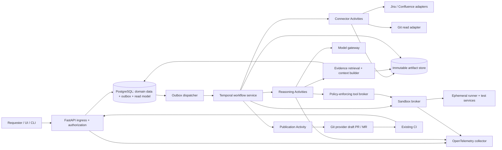

# Complete design handoff

Version 1.0 — 28 October 2026. This combines the prose specification for another chat. Separate files remain authoritative for navigation; contracts and synthetic examples accompany the repository/ZIP. This is a design, not a running platform.


---

Source document: README.md

# Framework-adaptive AI test generation — implementation handoff

**Version 1.0 · 28 October 2026 · Status: design specification, not an implemented or validated platform.**

This package specifies a system that turns Jira/Confluence requirements and application code into useful tests inside an existing automation project. The agent discovers the framework, reuses the project structure and helpers, evaluates existing coverage, generates missing tests, executes them, and delivers a reviewable change with evidence.

The framework-independent core is paired with qualified execution adapters. The initial complete scope demonstrates Python/pytest and TypeScript/Playwright Test, including a browser test; further frameworks are extensible additions. “Any framework” is a discovery and onboarding goal, not an unverified universal capability claim.

## Read and use the package

| Document | Contents |
|---|---|
| [Requirements](01-REQUIREMENTS.md) | 30 functional requirements, 16 nonfunctional requirements, use cases, workflow, security controls and definition of done |
| [HLD](02-HLD.md) | Components, trust boundaries, deployment, retrieval, durability, scaling, Git/CI and technology decisions |
| [LLD](03-LLD.md) | APIs, lifecycle/outcomes, data model, artifact contracts, adapter protocol, algorithms, idempotency and recovery |
| [Technology and sources](04-TECHNOLOGY-AND-SOURCES.md) | Selected stack, current AI/testing techniques, tool options, sources and version policy |
| [Implementation plan](05-IMPLEMENTATION-PLAN.md) | M0–M7 milestones, repository layout, build sequence, fixtures and release evidence |
| [Acceptance and evaluation](06-ACCEPTANCE-AND-EVALS.md) | 25 end-to-end acceptance scenarios, benchmark design, metrics and proposed pilot gates |
| [Next-chat prompt](07-NEXT-CHAT-PROMPT.md) | Ready-to-paste instructions for a separate coding chat |
| [Domain schema](contracts/domain.schema.json) | Named JSON Schema definitions for requests and core artifacts |
| [OpenAPI](contracts/openapi.json) | Proposed HTTP interface and typed request/response views |
| [Examples](examples/README.md) | Synthetic requests, requirement, oracle and result examples |

For another coding chat, provide access to this repository and paste `07-NEXT-CHAT-PROMPT.md`. If repository access is unavailable, attach the ZIP package or the combined design plus the contracts and examples. The implementation should start under `implementation/` unless you supply a different destination.

## Scope and assumptions

- Cloud-first reference integrations: Jira Cloud, Confluence Cloud and GitHub. Data Center and other Git hosts require separate configured adapters.
- One automation target repository per job; multiple application/contract repositories can supply context.
- Python control plane; target runtime and framework are discovered independently.
- Temporal is the sole durable workflow authority. PostgreSQL holds domain data and a status projection.
- Optional pgvector retrieval and additional model/agent roles are introduced through evaluation.
- Generated tests run in isolated environments. Publication also checks the target CI trust boundary.
- No automatic merge, deployment, product-code correction or production testing in the default scope.
- No real application repository, credentials, organization-specific policies or test environment were supplied for this design. No generated-suite performance has been measured.

## Authoritative contract rules

The requirements define required behavior; the LLD defines canonical field names, states and outcomes. Machine-readable contracts are the concrete starter interface baseline. Implementation must keep all three synchronized and record substantive changes in an ADR. A conflict is a specification defect to resolve explicitly, not permission to weaken requirements.

`COMPLETED` describes lifecycle only. Quality can be VERIFIED, VERIFIED_DEFECT_EXPOSING, SUSPECTED_PRODUCT_DEFECT, PARTIAL, BLOCKED, UNVERIFIED or REJECTED. Passing tests are not proof of correct requirements coverage; an appropriate failing test can expose a product defect.

The technology research was checked against official documentation and primary research on 28 October 2026. Links support tool capabilities; the selected architecture, budgets and thresholds are recommendations. Exact dependencies must be compatibility-tested and pinned during implementation.

## Verification of this package

Run `python3 scripts/validate_package.py` from this directory after installing the validation-only dependency with `python3 -m pip install -r requirements-validation.txt` in your chosen virtual environment. The check validates JSON syntax/schemas, example conformance, internal references, API references and required acceptance/requirement IDs. It does not run an implementation or prove the architecture's runtime behavior.

See [PACKAGE-VALIDATION.md](PACKAGE-VALIDATION.md) for the checks performed on the delivered version. `checksums.sha256` identifies the delivered source documents and contract files; Git provides the publication history.

After editing source documents, run `python3 scripts/build_package.py` to refresh the combined handoff and checksums, then run the validator.


---

Source document: 01-REQUIREMENTS.md

# Product requirements and workflow

Version 1.0 — 28 October 2026.

This is a proposed specification for implementation. It does not report measured results or imply that a framework, model, connector, or environment has already been validated. Quantitative targets below are initial engineering targets to confirm in a pilot.

## 1. Product objective and boundaries

Build a framework-adaptive system that consumes a bounded request, Jira issue content, approved Confluence specifications, selected application repositories, and an existing automation repository. It discovers the applicable test framework and conventions, identifies existing coverage, plans missing scenarios, edits the automation project, and returns a reviewable Git change with requirement traceability and execution evidence.

The system is successful when it produces maintainable, requirement-correct tests in the right project structure and honestly reports the evidence available. A passing runner alone is not proof of correct requirements coverage. A failing test can be a correct result when it demonstrates a product defect; it must retain its expected behavior and be classified and reviewed accordingly.

### In scope

- Unit, component, integration, contract, API, and UI scenarios when supported by the repository and execution environment.
- Multiple application repositories and an independently versioned automation repository.
- Existing suites with substantial coverage, sparse suites, and automation repositories with configured frameworks but no tests.
- Limited onboarding for an absent or unfamiliar framework, governed by an explicit capability contract.
- Source retrieval, structured plans, code patches, isolated validation, bounded repair, draft pull requests, and reviewer evidence.
- Re-running a request after requirement changes without duplicating generated suites.

### Out of scope by default

- Production data access, production mutations, destructive tests, load tests against shared systems, or unrestricted network access.
- Changing application behavior to make generated tests pass.
- Automatically resolving ambiguous business rules by imitating current code.
- Automatically merging a PR, deploying changes, or marking a Jira item complete.
- Claiming universal framework support before its discovery, runner, and validation capabilities have been verified.
- Replacing domain experts for business-rule conflicts or environment owners for unavailable dependencies.

### Mandatory MVP capability slice

The first complete implementation must demonstrate both Python/pytest and TypeScript/Playwright, including a browser UI scenario. This prevents the framework-independent claim from resting on one language or only unit tests. Additional adapters are phased extensions. The core workflow and artifact schemas must not embed pytest- or Playwright-specific assumptions; adapter implementations translate framework-specific collection, execution, fixtures, and results.

## 2. Actors, inputs, and deliverables

| Actor | Responsibility |
|---|---|
| Requester | Supplies desired scope, allowed repositories, requirements references, target branch/build, and execution constraints |
| Repository owner | Defines conventions, reusable infrastructure, permitted modifications, and review rules |
| Requirement owner | Resolves source conflicts and missing expected outcomes |
| Platform operator | Operates workers, model endpoints, connector credentials, policy, retention, and budgets |
| Reviewer | Reviews generated tests, classifies suspected product defects, and decides whether to merge |

Required request inputs are an automation repository, one or more requirement references or attached snapshots, and a target scope. Application repository access is preferred; if missing, the system may operate against approved interface contracts but must label the resulting coverage limitations. Execution credentials and environment availability are prerequisites for verified runtime results, not prerequisites for producing an unverified draft.

Required output bundle: source/version manifest, repository profile, requirement specification, coverage and scenario plan, Git patch or branch, validation report, requirement-to-test traceability matrix, execution logs with redaction, artifact checksums, and unresolved issues. A draft PR is created only when the project integration and request policy authorize it.

## 3. Use cases

| ID | Scenario | Expected behavior |
|---|---|---|
| UC-01 | Add scenarios to a populated automation repository | Reuse its framework, fixtures, naming, directory structure, data conventions, and runner |
| UC-02 | Existing tests partially cover a new Jira issue | Map actual assertions, extend existing tests where appropriate, generate only missing coverage |
| UC-03 | Framework configured, no tests | Verify a minimal discovery/execution probe, then create tests within the existing scaffold |
| UC-04 | No framework or scaffold exists | Propose an explicit onboarding decision using repository/organization evidence; require a configured policy or owner decision where selection is ambiguous |
| UC-05 | Unfamiliar framework or custom runner | Inspect and propose an adapter; enable execution only after the adapter contract passes; return a marked draft if verification is unavailable |
| UC-06 | Feature spans services in several repositories | Resolve service and contract versions and verify environment alignment before claiming cross-service validation |
| UC-07 | Jira and Confluence disagree | Apply configured field-specific source precedence; block only the unresolved scenarios and continue independent work |
| UC-08 | A generated test reveals a product defect | Preserve the assertion, attach reproducible evidence, report a candidate defect, and avoid weakening the test |
| UC-09 | Test environment is unavailable | Complete independent analysis and generation, publish an unverified/partial result, record the missing dependency |
| UC-10 | Request or worker retries | Resume from the last safe checkpoint without duplicate commits, suites, or PRs |
| UC-11 | Requirement or branch changes during generation | Detect drift, recompute impacted stages, and invalidate obsolete validation evidence |
| UC-12 | A user requests an unsupported/destructive test | Apply declared capability and execution policy; explain the unsupported or restricted action without silently expanding scope |

## 4. Functional requirements

The acceptance conditions below are implementation contracts. “Must” means required for the production path, and “should” denotes a recommended default that may be changed by an explicit project policy.

| ID | Requirement | Testable acceptance condition |
|---|---|---|
| FR-01 | Accept a typed, bounded generation request | Reject requests missing repository/scope/requirements references; store a normalized request, tenant, actor, idempotency key, and policy version |
| FR-02 | Preserve source access permissions | A request by a principal without access to a Jira issue, Confluence page, or repository cannot retrieve or infer its content through direct reads, cached retrieval, or generated output |
| FR-03 | Snapshot all inputs | Manifest contains source IDs, retrieval times, Jira update/version markers, Confluence page versions, repository commit SHAs, dependency lockfile hashes, and target environment build identifiers when available |
| FR-04 | Discover framework and conventions per module | Detect language/framework/build system, candidate test roots, naming/tag rules, fixtures, helpers, data lifecycle, CI jobs, and exact collection/execution commands with evidence locations and confidence |
| FR-05 | Verify discovered capabilities | The adapter can collect a known baseline suite and parse a representative result; unsupported collection/execution capabilities are explicit rather than guessed |
| FR-06 | Support sparse, empty, and unknown setups | Distinguish configured/no-tests from no-framework and unknown-framework; run the relevant onboarding path and never declare runtime validation from a fabricated runner command |
| FR-07 | Establish an immutable baseline | Store baseline commit, commands, collected test IDs, pass/fail/skip counts, known failures, and environment identity before modifications; if baseline cannot run, label it unavailable |
| FR-08 | Normalize requirements | Each acceptance criterion has a stable ID, source/version references, preconditions, action, expected result, applicability, ambiguity flags, and an approved interpretation if clarified |
| FR-09 | Resolve or expose source conflicts | Use organization/project precedence rules; unresolved contradictions produce a scenario-level blocker containing conflicting excerpts and a precise question |
| FR-10 | Retrieve relevant evidence with provenance | Context bundles identify retrieved files/symbols, source versions, filters, and selection rationale; every bundle observes tenant/repository authorization filters |
| FR-11 | Assess existing coverage by behavior | Coverage mapping records concrete test IDs and assertions supporting a criterion; name similarity without inspected assertions is marked only as a candidate match |
| FR-12 | Produce a structured scenario plan | Every in-scope criterion has one disposition: sufficiently covered, extend existing test, new test, blocked, excluded with approved reason, or not automatically verifiable |
| FR-13 | Choose an appropriate test layer | Each scenario records its chosen layer and reason, applicable existing test infrastructure, boundary conditions, data, and required integration points |
| FR-14 | Ground expected outcomes | Every material assertion traces to authoritative requirements, an approved contract, or a documented invariant; the system distinguishes specification-derived assertions from implementation characterization |
| FR-15 | Generate repository-native patches | New files, helpers, tags, imports, and suite registration obey the discovered conventions; planned helpers/selectors/APIs are checked for existence or created explicitly |
| FR-16 | Bound modification scope | Default writable scope is the automation project and approved test support files; application code, dependency upgrades, CI changes, generated baselines, and credentials require explicit scope policy |
| FR-17 | Make repeated requests idempotent | Stable scenario lineage and Git fingerprints prevent duplicate tests; changed requirements update or supersede previous scenarios with a recorded relationship |
| FR-18 | Validate discovery and execution | Run static checks, collection, generated tests, and affected regressions as available; verify the generated test IDs actually executed and do not count skipped/xfail/quarantined tests as passed |
| FR-19 | Classify failures before repair | Each failure is classified as generated test, suspected product defect, environment, baseline, requirement ambiguity, unsupported capability, or unknown, with evidence and confidence |
| FR-20 | Repair generated artifacts with bounded attempts | Default maximum is three repair attempts per scenario group, subject to token/time budgets; never remove assertions, reduce requirement coverage, broaden tolerances, introduce skips, or alter expected results solely to pass |
| FR-21 | Preserve defect-revealing tests | If the candidate test follows a resolved requirement and failure is reproducible, retain it and produce a candidate-defect report; a reviewer or independent evidence confirms the product-defect classification |
| FR-22 | Handle multi-repository alignment | Before cross-service claims, verify code/contract/build compatibility and environment identifiers; unknown alignment is reflected in validation status and the report |
| FR-23 | Support checkpoints and cancellation | A worker restart resumes the recorded stage; cancellation stops new work, interrupts cancellable jobs, cleans temporary credentials/workspaces, and preserves completed artifacts |
| FR-24 | Produce reviewable Git integration | Commits/PRs include requirement mapping, source/build versions, generated test IDs, checks, failing cases, and limitations; retried publication returns the existing PR instead of a duplicate |
| FR-25 | Detect source and target drift | Before publication, compare target branch and requirement versions against the snapshot; if changed, recompute impacted plans/patches and rerun checks affected by rebasing |
| FR-26 | Record audit and model evidence | Persist actor, stage, inputs/outputs hashes, model/version, prompt template version, tool decisions, policy denials, run costs, and validation artifacts without storing unredacted secrets |
| FR-27 | Support source updates and revocation | Updated/deleted documents invalidate indexes and caches; revoked access is enforced before retrieval and generation even when old artifacts remain under permitted retention |
| FR-28 | Separate generation from approval/publication | Policy determines whether a draft, branch, or draft PR may be created automatically; merge/deploy requires a separate authorization boundary |
| FR-29 | Demonstrate the MVP across languages and layers | The acceptance suite completes real collection/execution for a Python/pytest fixture and a TypeScript/Playwright browser fixture; both use the same core request/workflow/artifact contracts |
| FR-30 | Qualify remote CI execution | Generated-head CI uses isolated runners and scoped credentials; unsafe/unknown privileged execution blocks auto-publication and produces artifact-only delivery |

## 5. Workflow and state machine

The LLD defines the canonical lifecycle, stage and quality enums. Lifecycle is independent of quality: `COMPLETED` means processing and delivery finished; it does not imply passing tests or full scope coverage. PostgreSQL stores an idempotently updated read model of the authoritative Temporal workflow. No second process independently changes workflow progression.

| Ordered stage | Work | Required evidence / exception |
|---|---|---|
| AUTHORIZE | Validate request identity, source/target entitlements, quotas, publication and runner policies | Normalized request and immutable project policy revision; reject unauthorized input |
| SNAPSHOT | Capture documents and resolve repository refs | Immutable source manifest, ACL references and content hashes |
| DISCOVER | Inspect relevant modules, framework/configuration, helpers and CI commands | RepositoryProfile and qualified adapter; otherwise onboarding decision or explicitly unverified draft |
| BASELINE | Prepare sandbox, collect and run selected existing tests | Comparable baseline or explicit unavailable/empty baseline result |
| NORMALIZE | Extract criteria, normative behavior and conflicts | RequirementSpec; block only unresolved dependent scenarios |
| RETRIEVE | Retrieve relevant contracts, implementation, examples and actual existing assertions | Cited evidence bundle and existing coverage mapping |
| PLAN | Select scenarios, layer, test data, target paths, dependencies and assertions | Validated TestPlan and frozen AssertionOracle revisions; WAITING_REVIEW only if policy requires |
| GENERATE | Apply bounded changes to disposable automation checkout | Patch and assertion map referencing frozen plan/oracle |
| VALIDATE | Check scope, syntax, imports, test discovery, generated tests and relevant regressions | Normalized results bound to patch and environment hashes |
| DIAGNOSE | Compare results with oracle and baseline | Failure findings distinguish test errors, product defects, environment issues and unknowns |
| REPAIR | Correct eligible generated defects within budget | New patch revision with unchanged expected behavior; return to VALIDATE |
| REVIEW | Assess traceability, oracle fidelity, defects, reliability and remaining scope | ValidationReport and exact-revision review decisions when required |
| FRESHNESS | Recheck permissions, source versions, branch and validated tree | Invalidate affected artifacts on drift; replan/revalidate before verified publication |
| PUBLISH | Reconcile and create authorized artifact, branch or draft PR | Persist external IDs and content/tree hashes; no duplicate publication |
| CI | Observe configured CI gates for the exact published head | WAITING_CI while pending; failed/missing checks are visible; artifact-only jobs can mark CI not applicable |
| CLEANUP | Revoke leases/credentials and remove ephemeral compute/data | Retained evidence plus cleanup status; orphan-resource sweeper retries failures |

Lifecycle states: `QUEUED`, `RUNNING`, `WAITING_INPUT`, `WAITING_ENVIRONMENT`, `WAITING_REVIEW`, `READY_TO_PUBLISH`, `PUBLISHING`, `WAITING_CI`, `CANCELLING`, `COMPLETED`, `FAILED`, `CANCELLED`.

Quality outcomes: `UNASSESSED`, `VERIFIED`, `VERIFIED_DEFECT_EXPOSING`, `SUSPECTED_PRODUCT_DEFECT`, `PARTIAL`, `BLOCKED`, `UNVERIFIED`, `REJECTED`. The LLD defines their aggregation rules. A confirmed defect-exposing test can satisfy generation while failing a passing-CI merge gate. A suspected defect remains a candidate until adjudicated. Blocks, skips and missing validations never count as verified automated coverage.

Waiting states persist exact scenario, required decision/dependency, owner, artifact revision, resume prerequisites and expiry. Independent scenario groups continue first. Waiting holds no active runner; wait duration is separate from active execution budget. A terminal job is not resumed: create a linked successor job using prior immutable evidence where still valid.

Plan scenarios as a dependency DAG. Shared fixtures/setup have one writer. Independent groups use separate workspaces; serialize consolidation and validate the combined patch. Use isolated test namespaces/data or serialize groups sharing mutable state. A failed prerequisite blocks only dependent groups.

## 6. Nonfunctional requirements and initial targets

These targets are proposals for a pilot under a stated reference workload: a request with at most 10 acceptance criteria, 3 application repositories plus 1 automation repository, cached repository indexes, and generated-test runtime below 15 minutes. Larger repositories and slow UI suites require separate capacity classes. LLM and external service latency are observable dependencies; targets must be revised from measurements.

| ID | Requirement | Proposed initial acceptance target |
|---|---|---|
| NFR-01 | Durable job control | No acknowledged job lost during orchestrator/worker restart in fault-injection tests; checkpoint before externally visible side effects |
| NFR-02 | Submission responsiveness | p95 submission acknowledgement ≤2 seconds excluding user authentication redirect; processing is asynchronous |
| NFR-03 | Planning latency | p95 first reviewable plan ≤10 minutes for the reference workload with warm indexes; report cold-index timing separately |
| NFR-04 | Job latency | p95 completed draft ≤45 minutes for reference workload excluding human waits, environment outages, and test runtime beyond 15 minutes; do not guarantee arbitrary UI-suite completion |
| NFR-05 | Availability | Initial control-plane target 99.5% monthly excluding agreed maintenance; dependency degradation is visible rather than masked |
| NFR-06 | Cost control | Every job has configured money/token/tool/runtime caps; stop starting new paid activities at cap, with a bounded in-flight allowance stated in policy |
| NFR-07 | Isolation | Zero cross-tenant retrieval or execution access in the authorization test matrix; all tenant content queries carry enforced tenant and entitlement filters |
| NFR-08 | Cancellation | Stop scheduling within 5 seconds; terminate interruptible worker activities within 30 seconds; disclose non-interruptible external requests |
| NFR-09 | Observability | Every activity carries job/tenant/correlation identifiers; stage duration, failures, model usage, retries, and queue delay are measurable |
| NFR-10 | Artifact integrity | All delivered artifacts have content hashes and source lineage; executed patch hash equals delivered patch hash or validation is invalidated |
| NFR-11 | Reproducibility | Replay same snapshots, pinned dependencies, environment image, and committed tests without invoking the LLM; acknowledge that live systems and model generation can be nondeterministic |
| NFR-12 | Budgeted concurrency | Per-tenant and global limits for running jobs, workers, model calls, and target environment sessions; backpressure is explicit |
| NFR-13 | Retention and deletion | Retention is policy-configured by artifact class; deletion/revocation tested across primary storage, indexes, caches, and backups according to documented windows |
| NFR-14 | Disaster recovery | Proposed initial metadata RPO ≤15 minutes and RTO ≤4 hours; validate through restore drill before promising them |
| NFR-15 | Portability | A new framework adapter can be registered without altering requirement planning and orchestration domain logic |
| NFR-16 | Quality transparency | Every run reports denominators, skips, unavailable checks, blocked criteria, and uncertainty; no fabricated pass/coverage claims |

## 7. Security threat model, controls, and verification

Threat boundaries: requester to API; connector to retrieval/index; source text to model; model to tool executor; repository/generated code to sandbox; sandbox to application environment; worker to credentials/artifact store; tenant to shared infrastructure; publisher to Git host. The model is not an authorization authority. Deterministic policy and credentials constrain tool execution.

| Threat | Required control | Verification scenario |
|---|---|---|
| Cross-tenant or cross-project retrieval | Tenant partitioning plus source ACL/entitlement enforcement at ingestion and query; revocation-aware caches | Same semantic query from two principals returns only their permitted documents; revoke access and repeat against warmed cache |
| Prompt injection in Jira, Confluence, repository files, tool output, or logs | Treat external content as evidence; separate policies from retrieved text; allowlisted structured tools; authorization checked outside model | Seed a page/comment/README that asks the agent to exfiltrate credentials or change scope; confirm denied action and normal requirement processing |
| Arbitrary code execution from test code or package scripts | Ephemeral worker isolation, resource quotas, read-only base image, bounded writable workspace, no host socket, no privileged mode, scoped network | Malicious install/postinstall/test attempts host-file access, container escape prerequisites, infinite process spawning, and forbidden outbound calls; verify containment |
| Secret leakage to model/logs/patches | Short-lived scoped credentials injected only at execution, secret scanning/redaction, no secrets in prompts, minimum retention | Seed canary secret into environment/logs; verify it never appears in prompt capture, indexed data, patch, or deliverable |
| Source-code exfiltration | Approved model providers/endpoints and data policies, egress allowlist, bounded tool destinations | Source text instructs outbound upload; unauthorized destination fails and is audited |
| Destructive tests or production mutation | Environment inventory and allowlist; default non-production; operation-level capability policy and scoped accounts | Test proposes deleting shared data or points at production hostname; block before execution |
| Dependency/supply-chain abuse | Honor lockfiles, trusted registries, dependency provenance checks, explicit install policy, approved images | Dependency swap or unexpected install script cannot gain broader permissions; changed dependency lock requires review policy |
| PR tampering or validation mismatch | Immutable artifact hashes, commit provenance, check-to-patch linkage, drift revalidation | Modify patch after checks; publishing refuses verified status until affected checks rerun |
| Duplicate mutations after network timeout | Idempotency keys, unique job/publication constraints, external reconciliation | Git API response lost after PR creation; retry finds existing PR rather than creating another |
| Budget abuse and denial of service | Quotas, file/content limits, decompression limits, tool timeouts, cancellation, request rate limits | Huge generated logs, recursive tools, archive bombs, and timeout loops remain within quotas |
| Stored injection/XSS in reports | Escape untrusted excerpts and sanitize rendered HTML/links | Malicious Jira title/test log cannot execute script in the review UI |
| Artifact poisoning or unauthorized read | Encrypted storage, short-lived scoped download URLs, content hash verification, tenant access checks | Another tenant cannot access a guessed artifact ID; altered artifact hash is detected |
| Credential misuse by a generated command | Brokered tools receive task-scoped credentials only; command approval is based on policy and scope | Generated shell command cannot access connector refresh tokens or publish outside the allowed repo |
| Unapproved business-rule modification during repair | Assertion/oracle lineage checks; diff policy; reviewer gate for semantic changes | A failed test prompts weaker assertion, added skip, or broader tolerance; reject or require explicit requirement-backed change |

For mutually untrusted tenants, prefer stronger isolation than ordinary shared containers; select dedicated VMs or microVM-backed workers according to the deployment threat model. A container image by itself is not a security boundary against every hostile workload. Egress restrictions must be enforced at the network/runtime layer, not merely described in a prompt.

Do not index secrets or store full chain-of-thought. Retain concise decisions, cited evidence, tool actions, and structured reports needed for debugging and review. Separate audit access from general application access. Data residency, provider retention, and connector permission requirements are deployment decisions that must be resolved before real organizational data is processed.

The acceptance scenarios and evaluation plan are maintained in [06-ACCEPTANCE-AND-EVALS.md](06-ACCEPTANCE-AND-EVALS.md).


## 8. Definition of done for one generation request

1. Source versions, repository commits, environment identity, request scope, and policy are recorded.
2. All in-scope criteria have a disposition, and no unresolved criterion is silently counted as covered.
3. Planned tests are in the intended automation structure and reuse appropriate conventions and helpers.
4. The normal runner discovers generated tests; required checks ran against the delivered patch, or the exact missing validation is marked as a gap.
5. Assertions are grounded, meaningful, and retain required behavior throughout repairs.
6. Test results distinguish test defects, candidate/confirmed product defects, baseline failures, environment problems, and unknowns.
7. All in-scope tests required by the agreed plan are delivered, or the request is marked partial with explicit outstanding work.
8. The handoff contains the patch/PR, traceability, validation evidence, limitations, and next actions for unresolved items.
9. Temporary runtime resources and credentials are cleaned up; retained artifacts obey policy.

An accepted result may be verified-passing or verified-defect-exposing. A useful but unexecuted patch is a draft with gaps. No user-facing success message may collapse these distinct outcomes into “all tests complete and passing.”

## 9. Deployment decisions that must remain explicit

The implementation agent may develop locally with synthetic fixtures while these decisions are pending, but it must not invent organization-specific values or claim live integration:

- Jira/Confluence Cloud versus Data Center, allowed spaces/projects, and authentication method.
- Git provider, repositories, base branches, branch protection, and publication permissions.
- Model/provider allowlist, data residency and retention requirements, and spend budget.
- Expected tenant count, concurrency, repository sizes, test runtime distribution, and target availability.
- Test-environment inventory, sandbox access, secrets broker, approved network destinations, and production restrictions.
- Organization-specific requirement precedence, review rules, adapter approval, and dependency installation policy.
- Artifact retention/deletion windows, audit access, and incident response ownership.

The reference design should document defaults and provide configuration points for these choices. Absence of a real credential should not prevent building and testing connector interfaces using recorded synthetic fixtures; it does prevent claiming successful live authentication or end-to-end operation against the user's systems.

FR-30 applies to publication that triggers CI, including jobs with a validated local sandbox. Test it using AT-025.


---

Source document: 02-HLD.md

# High-level design (HLD)

Version 1.0 — 28 October 2026.

Research checked: **2026-10-28**. The architecture below is a proposed engineering design, not a claim that the named tools provide the complete product. Use current supported releases at implementation time, validate compatibility, and commit exact dependency lockfiles and image digests. Do not use floating `latest` production images or hard-code an unverified model/version recommendation.

## 1. Architecture decisions

1. Build a modular Python service with a framework-independent domain model. Target repositories may use any language; runner images and verified framework adapters provide the target runtime.
2. Use **Temporal as the single durable workflow authority**. Keep network I/O, model inference, database access, Git operations, and sandbox operations in Activities. Workflow code contains deterministic state transitions and policy decisions. Do not require LangGraph, Celery, Kafka, or a second workflow state machine for the initial implementation.
3. Expose a versioned **FastAPI + Pydantic** API. These tools provide typed validation and OpenAPI/JSON Schema integration; project-specific authorization and semantic validation must still be implemented. [FastAPI features](https://fastapi.tiangolo.com/features/)
4. Use **PostgreSQL** for requests, project configuration, requirement/scenario metadata, evidence references, publication records, audit entries, and a UI read model. Use an **S3-compatible object store** for immutable snapshots, patches, reports, and large logs. Temporal stores orchestration history; Postgres does not independently decide workflow transitions.
5. Start retrieval with exact repository search, document full-text search, and syntax-aware indexing. Add **pgvector** only when the evaluation demonstrates a retrieval benefit. pgvector supports vector similarity and can be combined with PostgreSQL full-text search; fusion and reranking are application behavior. [pgvector README](https://github.com/pgvector/pgvector)
6. Run target code and generated tests in an isolated **execution plane**, separate from connector, model, database, and publication credentials. A broker enforces validated tool contracts and execution policy.
7. Publish through a provider adapter into the existing Git and CI workflow. The default publication is a draft pull/merge request with evidence; merge policy remains with the repository owner.
8. Use **OpenTelemetry** for cross-service traces, metrics, and logs, exported to the organization's existing monitoring backend. It is instrumentation, not a replacement for a storage/dashboard backend. [OpenTelemetry observability primer](https://opentelemetry.io/docs/concepts/observability-primer/)

## 2. System context and component diagram



The diagram represents logical components. For the pilot, implement the API, connectors, retrieval, domain services, and publication adapters as modules of one codebase, with separate worker processes for independent security and scaling needs. Do not begin with independently deployed microservices for every box.

## 3. Responsibilities and interfaces

| Component | Responsibility | Important boundary |
|---|---|---|
| API / CLI | Authenticate requester; authorize source and target access; validate job; accept idempotency key; query status; submit explicit decisions/cancellation | Does not execute repository code or run long background jobs in the API process |
| Project configuration | Allowed repositories, source field mappings, precedence policy, trusted runner profiles, credential references, publication policy | References secrets; never embeds secret values in model context |
| Temporal workflow | Ordered stages, checkpoints, decision waits, budgets, retries, cancellation, compensation, final outcome | External I/O occurs in Activities |
| Connector workers | Permission-scoped source fetch, pagination, normalization, snapshot manifests, incremental refresh | Source text is evidence, not executable instruction |
| Repository profiler | Identify modules, framework versions, tests, fixtures, build/config/CI commands, test discovery; create candidate execution profile | Execution profile is policy-validated and probed before use |
| Retrieval service | Tenant/ACL-filtered exact, lexical, symbol and optional semantic retrieval; deduplicate; build cited context bundles | All reads tied to a snapshot manifest; no cross-tenant cache |
| Reasoning worker | Normalize requirements, plan scenarios, propose patches, classify failures, produce review findings | Typed outputs validated; bounded tool calls; cannot grant itself permissions |
| Model gateway | Provider abstraction, model routing, token budgets, timeouts, request metadata, output schema handling | No autonomous shell/Git privileges; model upgrades evaluated before rollout |
| Sandbox broker | Create runners, inject narrowly scoped environment access, execute approved argv commands, enforce quotas, collect reports, destroy resources | Control-plane secrets and host Docker socket unavailable to tested code |
| Artifact service | Content hashes, signed/authorized access, manifests, retention, lifecycle cleanup | Object-store metadata cannot bypass API authorization |
| Git publication adapter | Check base revision, commit allowed diff, create/update draft PR/MR idempotently, record provider IDs | No direct default-branch push, merge, or force-push by default |
| Evaluation service | Run versioned benchmark corpus; calculate correctness, coverage, defect sensitivity, maintainability, cost | Benchmark ground truth independent of generated output |
| Audit / observability | Who accessed what, policy decisions, tool execution outcomes, workflow correlations | Raw prompts/code/logs subject to redaction and retention rules |

## 4. Recommended technology matrix

| Concern | Initial selection | When to extend / substitute |
|---|---|---|
| Language / packaging | Supported Python release; `uv` or organization-standard package manager; committed lockfile | TypeScript is also viable if the implementation team is stronger in it; keep schemas/interfaces equivalent |
| API / validation | FastAPI, Pydantic; SQLAlchemy and Alembic for persistence/migrations | Existing organization framework takes precedence if compatible |
| Durable orchestration | Temporal Python SDK + managed or self-hosted Temporal service | Alternative durable engine only through a documented architecture decision |
| Domain metadata | PostgreSQL | Partition/archive based on measured volume; avoid premature distributed databases |
| Artifacts | Existing cloud object storage with S3-style interface, encryption and lifecycle rules | Local filesystem artifact adapter for offline development only |
| Exact retrieval | `rg`, Git file listing, bounded file reads | IDE/language-server symbol resolution as needed |
| Syntax retrieval | Tree-sitter per supported grammar; language tooling where higher semantic accuracy is needed | Dependency/service graph when multi-repository impact analysis warrants it |
| Lexical retrieval | PostgreSQL `tsvector`, GIN, `ts_rank_cd` | Search service such as OpenSearch if measured scale/relevance requires it |
| Semantic retrieval | Optional pgvector; embedding provider abstraction | Dedicated vector database only after an explicit benchmark or operational need |
| Hybrid ranking | Application-side reciprocal-rank fusion; optional reranker; exact symbol boosts | Calibrate using a labeled retrieval corpus, not self-assessed relevance |
| Target execution | OCI runner images plus container execution for trusted local pilot; stronger isolation for production untrusted workloads | gVisor or microVM platform selected after OS, browser, native dependency and nested-container compatibility tests |
| Git / CI | Provider REST API and Git subprocess through adapters; reuse existing CI | GitHub, GitLab, Bitbucket, Azure DevOps adapters implemented incrementally |
| Service authentication | OIDC for users; short-lived workload identities; existing secret manager | Enterprise federation and customer-managed encryption as needed |
| Telemetry | OpenTelemetry SDK/collector; existing metrics, traces and log backend | LLM evaluation dashboard optional, with code/privacy configuration checked |
| Dev environment | Docker Compose or equivalent: API, worker, Temporal, Postgres, local artifact service | Kubernetes optional when production scaling/operations already justify it |

PostgreSQL's built-in full-text rankers are `ts_rank` and `ts_rank_cd`; **do not label native `tsvector` ranking as BM25**. GIN is the documented preferred text-search index type. [Text search ranking](https://www.postgresql.org/docs/16/textsearch-controls.html), [Text-search indexes](https://www.postgresql.org/docs/16/textsearch-indexes.html)

## 5. Ingestion, source boundaries, and traceability

Implement `JiraCloudConnector` and `ConfluenceCloudConnector` first. Data Center is a phased/configured-deployment extension requiring distinct adapters. Do not route Cloud and Data Center through one assumed URL/auth/pagination implementation. The target product, deployment kind, base URL, and supported server version must be explicit project configuration.

For Jira Cloud use the documented REST v3 APIs; supported authorization and data representations depend on integration type. Configure acceptance-criteria extraction by tenant/project field mapping: it may be a custom field, part of the description, or an external linked document. Store raw and normalized forms and preserve ADF structure where applicable. [Jira Cloud REST v3](https://developer.atlassian.com/cloud/jira/platform/rest/v3/)

For Confluence Cloud, REST v2 supports cursor pagination; page APIs expose page body and version information and enforce page/space permissions. Capture page ID, version, body format, section anchor, retrieval time and content hash. Follow explicitly relevant links within configured bounds; support approved attachments through extraction adapters. Record unsupported macros or inaccessible attachments as gaps. [Confluence v2](https://developer.atlassian.com/cloud/confluence/rest/v2/), [Page API](https://developer.atlassian.com/cloud/confluence/rest/v2/api-group-page)

Data Center uses its own product/version-specific API documentation and authorization configuration. Implement and contract-test against the actual customer deployment; do not infer API compatibility from Cloud. [Jira Data Center API](https://developer.atlassian.com/server/jira/platform/rest/v10006/), [Confluence Data Center API](https://developer.atlassian.com/server/confluence/rest/latest/)

All connectors must honor `Retry-After`, use bounded backoff with jitter, page responses, and limit requested fields. Jira Cloud rate limiting has multiple mechanisms and current documentation distinguishes integration types; do not encode a presumed universal requests-per-minute quota. [Jira Cloud rate limits](https://developer.atlassian.com/cloud/jira/platform/rate-limiting/)

Each generation freezes a `SourceSnapshotManifest`. The block below is a conceptual source-plus-execution view; persist source facts separately from the derived ExecutionManifest as defined in LLD section 13:

```text
tenant_id, project_id, snapshot_id, captured_at, manifest_hash
sources[]:
  kind, provider, resource_id, canonical_url
  version_or_revision, source_updated_at, retrieved_at
  normalized_content_hash, raw_artifact_ref
  principal_scope_ref, permission_checked_at
repositories[]:
  repository_id, role(application|automation|contract), commit_sha
  submodule_and_lfs_refs, lockfile_hashes
test_environment:
  image_digests, application_build_ids, service_versions
```

Jira `updated` timestamps plus captured content hashes establish the ingested snapshot; they do not imply a transactional version shared with Confluence or Git. Before publishing, check relevant source and base-branch changes. If changes affect the plan, create a new snapshot and replan/revalidate. Preserve the old attempt for audit. Permission revocation must stop future retrieval and restrict access to stored derived artifacts according to retention policy.

## 6. Retrieval design

1. Apply tenant, project, source ACL and snapshot filters **before** candidate content reaches the model.
2. Search exact requirement identifiers, endpoints, public symbols and paths first.
3. Retrieve lexical matches and optional semantic matches in parallel; merge ranks and remove duplicate chunks.
4. Expand selected code units to required imports, fixture definitions, base classes and relevant call sites. Keep bounded file/repository budgets.
5. Include authoritative requirement spans, application contracts, representative existing tests and verified test commands in each scenario context bundle.
6. Record candidate IDs, chosen evidence, retrieval configuration version and exclusion reasons. Provide evidence references, not just text.

Chunk documents by sections/acceptance criteria and code by syntax units, with file and line anchors at pinned commits. Contextual summaries and embeddings are derivative indexes, never authoritative source replacements. Cache keys include tenant/principal scope, source hash, parser/chunker version and embedding model revision. A cache hit cannot extend previously granted access.

## 7. Durable execution, consistency, and recovery

Temporal workflows must remain deterministic; external calls and model invocations belong in Activities. Durable history records completed results for replay. Activities still require idempotency because a crash after an external side effect and before acknowledgement can cause retry. [Temporal workflow semantics](https://docs.temporal.io/workflows), [Temporal Python error handling](https://github.com/temporalio/documentation/blob/main/docs/develop/python/best-practices/error-handling.mdx)

Use a stable application-level `job_id` as the workflow ID, and an idempotency key unique within the tenant. API acceptance writes the job plus a transactional outbox record; an outbox dispatcher starts the workflow with the same ID. A crash between starting and marking the outbox delivered therefore does not create a second logical job. Report status through a Postgres projection with `projection_updated_at`; reconcile projection gaps with Temporal. Do not promise a distributed transaction across Temporal, Postgres, Git and object storage.

For model/tool loops, either make each model turn and tool batch its own Activity or persist a content-addressed checkpoint after each bounded step. Put only artifact references and small typed outputs in workflow history; keep full source files, tool transcripts, browser traces and test logs in artifact storage. On retries, load the latest committed checkpoint. Meter repeated paid model calls; when the provider supports request idempotency use it, otherwise record uncertain outcomes and enforce the budget.

Before side effects, create a unique action ledger record keyed by `(job_id, stage, logical_action_id)`. For branch/PR creation, combine a deterministic branch name and an external job marker, check provider state before retry, and record the resulting provider identifiers. This is reconciliation-based idempotence, not an exactly-once external-write guarantee.

Long execution Activities heartbeat runner IDs and progress. On worker loss, a new worker checks the broker for an existing runner before launching a replacement. Cancel requests propagate to runners; cleanups revoke temporary credentials and destroy compute. Retain immutable evidence already produced. Lease expiry and a separate sweeper remove orphaned resources if cleanup fails. Workflow-code upgrades must be compatible with in-flight histories, using the chosen Temporal versioning strategy and replay tests.

Retry transient connector/rate-limit/runtime failures with policy-defined limits. Authentication failures, invalid inputs, unsupported frameworks, policy violations, unresolved requirement conflicts and reproducible product failures must not be blindly retried. Those produce typed outcomes or a decision wait. Overall and stage budgets cap runtime, model spend, repair iterations, tool calls and artifacts.

## 8. Isolation and security design

The trust boundary separates the control plane from arbitrary build scripts, dependency installation, application execution, browser pages and generated test code. No model API keys, Git write tokens, connector tokens, database admin credentials or host runtime socket enter the target runner. Use narrow read tokens only when necessary for dependencies, with audited egress and expiration.

For a trusted internal pilot, restricted containers can be a practical development arrangement. For production untrusted repositories, evaluate gVisor or a managed/self-hosted microVM substrate; ordinary shared-kernel containers alone are not the design's isolation guarantee. gVisor narrows host-kernel exposure but does not prevent a workload from using resources and permissions intentionally granted inside its sandbox. Firecracker's jailer adds process isolation around Firecracker. Neither removes the need for network, credential and resource policies. [gVisor security model](https://gvisor.dev/docs/architecture_guide/intro/), [Firecracker jailer](https://github.com/firecracker-microvm/firecracker/blob/main/docs/jailer.md)

Enforce non-root execution, no privileged mode, restricted mounts, read-only base images, CPU/memory/PID/disk/time limits, command argument validation, allowlisted egress, metadata-endpoint blocking and per-job workspaces. Package installation executes code too; run it inside the same trust boundary. UI tests requiring browsers, mobile tests requiring devices, Windows-only frameworks and nested-container integrations need separate validated runner classes. Do not claim a universal Linux runner handles them all.

Use shared-database tenant filtering plus row-level security as defense in depth. Application roles must not own tables or have `BYPASSRLS`; owners/superusers can bypass ordinary RLS, which the PostgreSQL documentation explicitly describes. Test isolation including search results, artifacts, logs and signed URLs. [PostgreSQL row security](https://www.postgresql.org/docs/17/ddl-rowsecurity.html)

## 9. Git and CI integration

For GitHub, a GitHub App offers granular repository permissions and scoped installation access; require only the permissions needed for cloning, branches/contents, pull requests and status reporting. Equivalent provider-specific credentials are required for GitLab/Bitbucket/Azure DevOps. CI workflow edits are a separate scope because they can change what executes with CI secrets. [GitHub App permissions](https://docs.github.com/en/apps/creating-github-apps/registering-a-github-app/choosing-permissions-for-a-github-app)

Process webhooks by validating signature, deduplicating delivery ID, persisting to the inbox and returning promptly. Then handle asynchronously. Never assume events arrive once or in order. Reconcile repository head, PR state and CI status by polling when necessary: GitHub documents that failed webhook deliveries are not automatically redelivered. [GitHub webhook practices](https://docs.github.com/en/webhooks/using-webhooks/best-practices-for-using-webhooks), [Failed deliveries](https://docs.github.com/en/webhooks/using-webhooks/handling-failed-webhook-deliveries)

Build a patch against the pinned automation commit. Verify changed paths and patch scope. Before publication, compare the target branch head; rebase/apply and rerun relevant validation on any changed base. Serialize publication per repository/base target where overlapping changes would conflict. A PR records base SHA, patch SHA, tested SHA, source snapshot ID and environment build IDs so reviewers can identify precisely what was tested.

## 10. Deployment, scaling and operations

**Local/offline development:** API, Temporal development service, worker, Postgres, local artifact adapter, mocked/read-only connectors, deterministic fake model provider and sample repositories. Docker-based runners are development-only unless the selected trust model permits them. A fake provider enables testing orchestration without paid model calls.

**Pilot deployment:** one region; managed Postgres/object store; managed or operated Temporal; separate API, connector/reasoning workers and isolated execution pool. Use a supported registry of runner images. Integrate existing CI instead of duplicating its entire service stack.

**Production:** redundant stateless API and worker replicas; HA database/Temporal deployment consistent with organization standards; queue-based worker scaling; per-tenant concurrency and spend limits; separate task queues for expensive UI, ordinary code, network connectors and publication. Keep object-store payloads outside workflow histories. Size on observed queue latency, activity duration, runner utilization and provider rate limits. Browser execution, model quotas and external test environments may be the bottlenecks, not the API.

Use backup/restore drills for Postgres and configuration; record object-store retention and recovery policies; test Temporal recovery and replay across upgrades. Choose RPO/RTO and retention with stakeholders rather than presenting unmeasured guarantees. Indexing is eventually consistent; run execution is snapshot-consistent. Make indexing freshness and authorization freshness visible.

Required metrics include accepted/completed/partial/blocked jobs; stage duration; queue time; token and execution cost; repair count; requirement-gap count; discovery failures; baseline failures; flaky outcomes; provider throttling; publication duplicates/conflicts; orphan runners; and access denials. Correlate `tenant_id` (appropriately protected), `project_id`, `job_id`, workflow/activity IDs, `scenario_id`, model invocation IDs and artifact IDs. Do not make raw code, prompts or secrets default telemetry attributes.

## 11. Implementation acceptance checks for this HLD

- Kill a worker during a long job; recovery resumes without duplicate publication.
- Submit the same idempotency key twice; return the same logical job; reject changed payload with the same key.
- Inject a connector 429; honor retry timing and remain within job budget.
- Revoke source permission; subsequent retrieval and artifact access deny correctly.
- Change an application/automation revision during a run; final evidence identifies the exact snapshots and drift is handled before publication.
- Execute malicious repository scripts in a fixture sandbox; they cannot obtain control-plane credentials or unauthorized network access.
- Generate against representative Python/pytest and TypeScript/Playwright automation repositories; add Java and other adapters only after separate qualification. Discovery and runner contracts remain separate from domain logic.
- Simulate missing CI webhook delivery; reconciliation updates the status.
- Attempt a cross-tenant vector/full-text query; no content or metadata leakage occurs.
- Exhaust a repair/time/cost budget; produce a truthful partial/failed outcome with retained evidence rather than silently reporting success.

All linked sources were accessed **2026-10-28**. Specific capability statements are supported by their links; stack selection, boundaries, state ownership, schemas and acceptance criteria are design recommendations for this platform.

## 12. Remote CI qualification

The trust boundary extends through publication into the target CI runner. Before a project may publish generated code, qualify its PR-triggered CI for scoped tokens, isolated execution and absence of production secrets. Reject privileged execution of generated heads, including unsafe trusted-event workflows. Where CI policy is unknown, provide an artifact-only result until onboarding resolves it. The LLD section 18 and acceptance case AT-025 define the check.


---

Source document: 03-LLD.md

# Low-level design: framework-adaptive test-suite generation

This is a proposed implementation contract, not a claim that the system is already implemented or validated. The first production candidate supports Python pytest and TypeScript Playwright Test through explicit adapters. Other frameworks can be detected and reported; runtime-verified generation is unsupported until an adapter is implemented and qualified. An explicitly requested unverified draft may be produced when sufficient conventions and oracle evidence exist, with no claimed execution. Framework-independent orchestration does not imply universal framework support.

## 1. Service and package boundaries

Use Python for the control plane: FastAPI, Pydantic, SQLAlchemy, Alembic, PostgreSQL, Temporal Python SDK, and an S3-compatible artifact store. Use ordinary Python services and typed provider-neutral LLM calls inside Temporal activities. Do not add a second durable orchestration engine in the initial implementation. The TypeScript Playwright adapter runs Node commands inside the test sandbox; it does not require a TypeScript control plane.

Use the canonical package layout in [05-IMPLEMENTATION-PLAN.md](05-IMPLEMENTATION-PLAN.md). Domain modules live under `src/testagent/`; API, Temporal workers and runner workers are separate entry points/processes in that single codebase. The `schemas/`, `migrations/`, `prompts/`, `policies/`, `runner-images/`, `tests/` and `benchmarks/` directories remain separate. Module names in examples describe responsibilities, not a second repository layout.

The public API accepts identifiers and policy choices, never arbitrary terminal commands or access tokens. Secrets are referenced through configured connection IDs. The agent can request tools only from a capability set assigned to its activity; a model-generated action does not create permission.

## 2. HTTP contracts

User-facing resource endpoints require OIDC authentication and tenant-scoped authorization. Provider webhooks use provider-specific signature/authentication verification instead of OIDC. Every ID lookup must include `tenant_id`; object-storage URLs are short lived and issued only after authorization. User-facing mutating methods accept `Idempotency-Key`; provider webhooks deduplicate by verified connection and delivery ID. Return RFC 9457-style problem details with a stable application `code`, request ID, and safe diagnostics.

| Method and path | Behavior |
|---|---|
| `POST /v1/projects` | Register repository roles, connections, adapter policy, permitted environments, and publication policy. |
| `GET /v1/projects/{project_id}` | Return non-secret configuration and capability readiness. |
| `PATCH /v1/projects/{project_id}` | Create a new immutable configuration revision; do not mutate running-job configuration. |
| `POST /v1/projects/{project_id}/discovery-runs` | Detect frameworks, commands, candidate suite roots, and missing setup. No generation. |
| `GET /v1/discovery-runs/{discovery_run_id}` | Return profile and capability-verification results. |
| `POST /v1/source-snapshots` | Register a bounded attached requirement snapshot with provenance and original reference; validate size/type and store immutable bytes. |
| `GET /v1/jobs/{job_id}/blockers` | Return versioned questions/dependencies and affected scenarios. |
| `POST /v1/jobs/{job_id}/blockers/{blocker_id}/resolutions` | Submit an evidence-backed answer against the blocker revision; owner authorization and `If-Match` required. |
| `GET /v1/artifacts/{artifact_id}/download` | Return a short-lived authorized download reference, or stream local-development content. |
| `POST /v1/jobs` | Validate scope, persist job/outbox, and start durable work asynchronously; return `202`. |
| `GET /v1/jobs/{job_id}` | Return lifecycle state, current stage, quality outcome, blocker codes, and summary. |
| `GET /v1/jobs/{job_id}/events` | SSE events with monotonically increasing sequence IDs; support `Last-Event-ID`. |
| `GET /v1/jobs/{job_id}/requirements` | Return versioned requirement records and unresolved conflicts. |
| `GET /v1/jobs/{job_id}/test-plan` | Return scenario plan, coverage disposition, and assertion oracles. |
| `GET /v1/jobs/{job_id}/artifacts` | List authorized artifact metadata; individual download endpoint signs a URL. |
| `GET /v1/jobs/{job_id}/validation-report` | Return machine-readable checks, baseline comparisons, and unmet gates. |
| `GET /v1/jobs/{job_id}/reviews` | Return pending and completed review requests. |
| `POST /v1/jobs/{job_id}/reviews/{review_id}/decisions` | Resolve one exact artifact revision with decision and optional correction; `If-Match` guards stale decisions. |
| `POST /v1/jobs/{job_id}/resume` | Resume a waiting job after an identified dependency is resolved; includes expected blocker revision. |
| `POST /v1/jobs/{job_id}/cancel` | Signal cancellation, terminate active sandbox process, and clean up leases. |
| `POST /v1/jobs/{job_id}/publish` | Publish the validated artifact revision under project publication policy; `If-Match` required. |
| `GET /v1/jobs/{job_id}/pull-requests` | Return publication status and linked Git-provider PRs. |
| `POST /v1/webhooks/{provider}/{connection_id}` | Verify signature, deduplicate delivery, persist event, enqueue processing, return promptly. |

For routes whose provider uses different webhook authentication, implement the provider's verified mechanism; do not invent an HMAC requirement for every service. Webhooks may mark snapshots stale or update CI checks. They do not silently replace accepted requirements or initiate paid jobs unless a configured trigger permits it.

Example create request:

```json
{
  "project_id": "prj_checkout",
  "source_refs": [
    {"kind": "jira_issue", "connection_id": "conn_jira", "external_id": "PAY-241"},
    {"kind": "confluence_page", "connection_id": "conn_confluence", "external_id": "92417"}
  ],
  "repository_refs": [
    {"repository_id": "repo_backend", "ref": "main", "role": "application"},
    {"repository_id": "repo_tests", "ref": "main", "role": "automation"}
  ],
  "scope": {"suite_roots": ["tests/payments"], "test_layers": ["api"], "scenario_limit": 20},
  "environment_id": "env_ephemeral_checkout",
  "publication_mode": "draft_pr",
  "limits": {"wall_clock_seconds": 1800, "model_cost_usd": 10.0, "repair_attempts": 3}
}
```

Limits are illustrative initial guardrails, not measured capacity promises. The server applies the minimum of request limits and tenant/project limits. A caller cannot raise its own permissions or budgets. `draft_pr` is accepted only if project policy and caller scope authorize it; otherwise the request fails with an explicit policy error rather than silently escalating.

Example accepted response:

```json
{
  "job_id": "job_01JEXAMPLE",
  "state": "QUEUED",
  "stage": null,
  "quality_outcome": "UNASSESSED",
  "status_url": "/v1/jobs/job_01JEXAMPLE",
  "events_url": "/v1/jobs/job_01JEXAMPLE/events"
}
```

Repeated identical request/key returns the original response and job ID. Reusing the key with a different canonical request body returns `409 IDEMPOTENCY_KEY_REUSED`. Retain request idempotency records for a documented interval; use generation and publication uniqueness constraints to prevent duplicates after expiry.

## 3. Durable state machine

Separate lifecycle from test quality; a technically completed workflow may have discovered a product defect or produced only a partial result.

```text
JobState = QUEUED | RUNNING | WAITING_INPUT | WAITING_ENVIRONMENT |
           WAITING_REVIEW | READY_TO_PUBLISH | PUBLISHING | WAITING_CI |
           CANCELLING | COMPLETED | FAILED | CANCELLED

Stage = AUTHORIZE | SNAPSHOT | DISCOVER | BASELINE | NORMALIZE | RETRIEVE | PLAN |
        GENERATE | VALIDATE | DIAGNOSE | REPAIR | REVIEW | FRESHNESS | PUBLISH | CI | CLEANUP

QualityOutcome = UNASSESSED | VERIFIED | VERIFIED_DEFECT_EXPOSING | PARTIAL |
                 SUSPECTED_PRODUCT_DEFECT | BLOCKED | UNVERIFIED | REJECTED
```

`VERIFIED` means configured gates passed for the declared scope and evidence; it is not a guarantee of complete bug detection. `BLOCKED` means no usable test patch or qualified existing-coverage result can be produced because a required capability, authorization or requirement resolution is missing. A usable patch with insufficient execution evidence is UNVERIFIED instead. `COMPLETED/PARTIAL` is valid when the user receives the finished subset and explicit uncovered criteria. `FAILED` is reserved for unrecoverable orchestration/infrastructure failure or exhausted execution budget without a deliverable. Cancellation is terminal for that job; restarting creates a new job linked by `replaces_job_id`.

| Current state/event | Next state | Required behavior |
|---|---|---|
| `QUEUED` / admitted by tenant quota | `RUNNING` | Resolve source and repository refs to immutable versions. |
| `RUNNING` / critical requirement ambiguity | `WAITING_INPUT` | Persist exact question, affected scenarios, and evidence; independent scenarios may finish first. |
| `RUNNING` / environment dependency unavailable | `WAITING_ENVIRONMENT` | Record missing dependency and retry policy; preserve artifacts. |
| `RUNNING` / policy requires artifact review | `WAITING_REVIEW` | Freeze artifact hash; expose diff and validation evidence. |
| `WAITING_*` / valid resolution | `RUNNING` | Resume from a checkpoint; invalidate downstream artifacts if inputs changed. |
| `RUNNING` / validated deliverable, manual publication | `READY_TO_PUBLISH` | Return downloadable patch and complete report. |
| `RUNNING` or `READY_TO_PUBLISH` / authorized publication | `PUBLISHING` | Recheck authorization, remote head, source freshness, and artifact hash. |
| `PUBLISHING` / external effect verified | `WAITING_CI` or `COMPLETED` | Persist external IDs; wait if CI gates are required, otherwise finish with applicable limitations. |
| `WAITING_CI` / generated-code failure with repair budget | `RUNNING` at DIAGNOSE | Diagnose/repair, revalidate, recheck freshness, update the same PR and wait for checks on the new head. |
| `WAITING_CI` / checks settled and no repair eligible, or deadline | `COMPLETED` | Aggregate exact-head evidence and gaps; failed/timed-out checks never become passed. |
| `RUNNING` / artifact-only mode finished | `COMPLETED` | Return artifacts; do not require publication to finish. |
| Any nonterminal state / cancel | `CANCELLING` then `CANCELLED` | Stop processes and cleanup; preserve audit records. |
| Any running state / unrecoverable error | `FAILED` | Preserve evidence and indicate whether an external effect may have occurred. |

Use a deterministic Temporal workflow for branching, timers, waits, and retry decisions. Network calls, Git access, model inference, sandbox execution, and database mutations are activities. Persist large artifacts in object storage and pass immutable references through workflow history. Heartbeat long-running activities and check cancellation. A bounded inference activity can manage a short agent tool loop, but every tool invocation is separately audited and budget checked.

An approval/correction resolves a `ReviewRequest` with an artifact revision. Corrections create a new artifact revision and invalidate dependent plans, patches, and reports. A reviewer cannot approve a stale revision by accident.

### Outcome aggregation and CI completion

Apply summary rules in this order, while retaining every scenario-level finding:

1. Policy/review rejection => REJECTED. No deliverable and missing prerequisites => BLOCKED. Infrastructure lifecycle FAILED remains distinct from quality.
2. If the request has a usable patch or inspected existing coverage but no sufficiently validated scenario, use UNVERIFIED, unless the entire exercised scope meets the candidate-defect criteria below.
3. If some scenarios are adequately validated and others remain blocked, unverified or missing, use PARTIAL. Do not count blocked criteria as passing merely because their disposition is recorded.
4. For fully exercised/resolved scope with oracle-supported application contradictions awaiting adjudication, use SUSPECTED_PRODUCT_DEFECT.
5. For fully exercised/resolved scope with independently confirmed defects and passing artifact/oracle/traceability gates, use VERIFIED_DEFECT_EXPOSING. Relevant test/CI failure remains failed; generation quality and merge eligibility are separate. This outcome cannot override a required green-CI merge policy.
6. For complete declared scope satisfying configured passing validation gates, use VERIFIED.

`UNASSESSED` applies before assessment. Failure findings, criterion dispositions, check results and `merge_eligible` remain separate facts; a single enum never replaces those details. An unknown failure explanation cannot become a confirmed defect.

For all-existing-coverage/no-change jobs, VERIFIED requires inspected assertion evidence and the configured validation gates; no PR is required. Record `delivery_kind=no_change`. For no-change jobs, required CI results are queried for the pinned automation base commit; unavailable relevant checks are a gap, and no dummy PR is created. A required CI gate pending after publication keeps lifecycle WAITING_CI; a timeout yields an explicit missing-check result and PARTIAL/UNVERIFIED outcome. Optional CI observation can continue after completion as a separate monitor, without retroactively rewriting the immutable report. Publish a new report revision for new evidence. Completion fraction is criterion accounting, not runtime coverage.

## 4. Persistence model

Use UUIDv7 or an equivalent sortable opaque ID internally; external examples above use readable aliases. Store timestamps in UTC and render in the user's timezone. Binary artifacts and large logs belong in object storage; database rows retain hashes, URI, media type, size, ACL scope, and expiry.

| Entity | Essential fields / constraints |
|---|---|
| `tenants` | `id`, policy revision, quotas, retention policy. |
| `projects` / `project_revisions` | Tenant, immutable versioned repository/environment/publication configuration. |
| `connections` | Provider, tenant, secret reference, allowed resource scopes, health; no access token in rows exposed to agents. |
| `repositories` | Provider ID, URL, role, permitted refs and path scopes. |
| `jobs` | Tenant/project/config revision, lifecycle state, stage, quality outcome, limits, request principal, generation key, optimistic row version. |
| `job_input_snapshots` | Immutable manifest, content hash, resolved revisions, ACL snapshot reference, environment fingerprint. |
| `source_documents` / `source_chunks` | External ID/version, text hash, source link, heading/anchor, tenant/project ACL scope, embedding model/version. |
| `repository_profiles` | Job/repository/module, schema version, detected adapter version, evidence and verified commands. |
| `requirement_specs` | Job, stable criterion key, revision, normalized behavior, source refs, conflict status. |
| `test_plans` / `scenarios` | Revision, coverage disposition, oracle refs, target paths, generation status. |
| `assertion_oracles` | Immutable revision/hash, assertion descriptions, structured predicates, evidence refs, review status. |
| `patches` | Base commits, file operations, diff hash, scenario mapping, generated commit. |
| `execution_runs` / `test_results` | Phase, environment fingerprint, command ID, attempt, test ID, outcome, duration, failure signature, report artifact. |
| `validation_reports` | Artifact revision, gate results, baseline diff, unresolved criteria, quality outcome. |
| `review_requests` / `review_decisions` | Type, artifact hash, status, actor, rationale, decision timestamps. |
| `publications` | Repository, generation key, branch, commit, provider PR ID, state and reconciliation status. |
| `job_events` / `audit_events` | Monotonic sequence, event type, safe payload, actor, trace ID. |
| `idempotency_records` / `webhook_deliveries` | Unique tenant/key or provider connection/delivery ID; payload hash. |
| `outbox_events` | Committed with business state, processed idempotently by dispatcher. |
| `leases` | Tenant/repository/branch scope, owner, expiry, fencing token. |

Enforce tenant filtering in the application and database policy where feasible. Retrieval queries apply ACL predicates before ranking, including vector search. Cached chunks and evidence bundles are scoped to the same authorization context; a shared vector index must never return an unauthorized chunk to the model.

## 5. Shared contract envelope

Every generated artifact has:

```json
{
  "schema_version": "1.0",
  "artifact_id": "art_...",
  "revision": 1,
  "job_id": "job_...",
  "created_at": "2026-10-28T09:00:00Z",
  "input_manifest_sha256": "...",
  "parent_artifact_hashes": ["..."],
  "content_sha256": "...",
  "producer": {"component": "planner", "version": "0.1.0"}
}
```

Serialize using canonical JSON before hashing. Source references include `source_id`, exact revision, content hash, paragraph/heading or file/line range, and human-readable URL. File/line evidence is always anchored to a commit. Model outputs are parsed against Pydantic schemas, validated semantically, and rejected on unknown properties. Schema validity alone does not establish factual correctness.

### SourceSnapshotManifest and ExecutionManifest

The following is a conceptual combined view. Persist the source and execution parts separately as specified in section 13; `InputManifest` is an umbrella term, not a third mutable object.

```text
InputManifest
  project_config_revision
  repositories[]: repository_id, role, requested_ref, resolved_commit_sha,
                  submodule_commits, lockfile_hashes, sparse_checkout_paths
  sources[]: source_id, kind, requested_reference, resolved_revision,
             updated_at, content_sha256, acl_scope_reference
  environment: environment_id, application_builds[], sandbox_image_digest,
               runtime_versions, service_image_digests[], config_digest,
               feature_flag_digest, test_data_revision, region_or_locality
  tooling: adapter_versions, generator_version, retrieval_config_version,
           policy_revision, prompt_template_hashes, model_config_ids
  request: scope, principal_reference, budget_limits
```

Do not hash raw low-entropy secret values; fingerprints contain non-secret configuration and secret version identifiers where permitted. An environment fingerprint is useful only if the deployment/build identity is actually observable. If it is unknown, record `unknown` and lower verification status rather than manufacturing reproducibility.

### RepositoryProfile

```text
RepositoryProfile
  repository_id, commit_sha, module_root
  framework_candidates[]: name, version, evidence_refs[], status
  selected_adapter: adapter_id, adapter_version, capabilities
  runtimes[], package_manager, lockfiles[], dependency_policy
  test_roots[], naming_patterns[], test_layers[]
  fixtures[], helpers[], page_objects[], api_clients[], factories[]
  abstraction_ref: symbol, file_path, commit_sha, signature, usage_examples[]
  commands: prepare_command_id, collect_command_id, run_command_id,
            static_check_command_ids[], format_command_id
  suite_registration: discovery_rules[], explicit_manifests[], CI_jobs[]
  lifecycle: setup_refs[], teardown_refs[], test_data_strategy
  execution_readiness: ready | dependency_missing | unsupported | unverified
  detected_evidence[], verified_probes[], unresolved_items[]
```

`framework_candidates` are evidence-backed hypotheses; only a successful collect/probe establishes executable adapter readiness. Multiple modules may have different profiles. Existing wrapper commands such as `make test-api` or an npm script take precedence when they are verified and policy approved.

### RequirementSpec

```text
RequirementSpec
  requirement_id, stable_criterion_key, revision
  title, normative_statement
  source_refs[], authority_resolution
  actor, preconditions[], action, expected_outcomes[]
  boundaries[], permissions[], state_transitions[], failure_behaviors[]
  scope: services[], feature_flags[], supported_versions[]
  status: resolved | ambiguous | conflicting | not_testable | out_of_scope
  questions[]: question_id, text, evidence_refs[], affected_scenarios[]
  assumptions[]: text, provenance, approval_status
```

Authority precedence is project configuration, not a hard-coded “Jira always wins” rule. An acceptance criterion may reference a normative Confluence section. Preserve both references. Existing implementation behavior may help identify interfaces but cannot silently override a normative expected outcome.

### TestPlan and AssertionOracle

```text
TestPlan
  plan_id, revision, profile_hashes[], requirement_hashes[]
  scenarios[]:
    scenario_id, stable_scenario_key, requirement_ids[]
    coverage_disposition: existing | extend_existing | new | blocked |
                          out_of_scope | not_automatable
    existing_test_refs[], coverage_reason
    layer: unit | component | integration | contract | api | ui | performance
    target_repository_id, target_suite_root, target_paths[]
    priority, preconditions[], data_requirements[], ordered_actions[]
    oracle_id, oracle_revision, oracle_sha256
    reusable_abstractions[], environment_dependencies[]
    cleanup_requirements[], estimated_execution_class, blockers[]
  criterion_dispositions[]: requirement_id, scenario_ids[], disposition, reason

AssertionOracle
  oracle_id, revision
  assertions[]:
    assertion_id, behavior_statement
    observable, comparison_operator, expected_value_or_invariant
    units_or_normalization, tolerance_policy, temporal_bound
    evidence_refs[], provenance: requirement | contract | approved_invariant
  prohibited_weakening[]
  review_state: policy_accepted | human_accepted | needs_resolution
  sha256
```

Not every assertion can use a tiny fixed expression language. Structured observable/predicate fields provide traceability; framework-native assertion code is still generated. The validator checks that code expresses the planned oracle and that it is exercised. Human-readable invariants require review when mechanical validation cannot establish equivalence.

An oracle is frozen before generation. The coding/repair activity has read access only to that revision. A legitimate oracle correction requires a new requirement/plan revision with evidence or authorized review, invalidates dependent validation, and triggers regeneration. Do not let the same repair call edit both the expectation and the implementation to make tests pass.

### PatchManifest

```text
PatchManifest
  patch_id, revision, plan_hash, input_manifest_hash
  repositories[]:
    repository_id, base_commit_sha
    file_changes[]: path, operation: add | modify | delete,
                    before_sha256, after_sha256, scenario_ids[], purpose
    unified_diff_artifact, diff_sha256
  dependency_changes[], suite_registration_changes[]
  assertion_map[]: assertion_id, generated_file, generated_symbol,
                   oracle_sha256
  forbidden_change_scan, generated_commit_sha
```

Default writable scope is the designated automation repository and approved test-support paths. New dependencies, fixture changes with broad impact, CI changes, or application changes are distinct policy decisions. A generation job does not gain permission to rewrite application behavior to satisfy a test.

### ValidationReport

```text
ValidationReport
  report_id, revision, patch_hash, plan_hash, environment_fingerprint
  quality_outcome, delivery_kind, merge_eligible, completion_fraction
  gates[]: gate_id, status: passed | failed | blocked | not_applicable,
           evidence_artifact_refs[], explanation
  collection: baseline_test_ids[], candidate_test_ids[], added[], removed[],
              generated_tests_collected[], registration_warnings[]
  baseline_comparison: new_failures[], persistent_failures[], resolved_failures[],
                       incomparable_results[], selection_differences[]
  runs[]: execution_run_id, phase, command_id, exit_code, result_summary,
          normalized_result_artifact_ref
  requirement_coverage[]: requirement_id, disposition, scenario_ids[], evidence
  oracle_review[], defect_sensitivity_evidence[], flakiness_evidence[]
  failure_findings[], uncovered_criteria[], verification_limitations[]
  repair_history[], publication_eligibility, publication_restrictions[]
```

Completion fraction counts dispositioned criteria; it must not be presented as passed-test percentage. Report blocked/out-of-scope criteria separately. A criterion linked to a test name is not automatically covered; assertion mapping and review evidence are required.

## 6. Adapter protocol and command execution

```python
from typing import Protocol

class FrameworkAdapter(Protocol):
    def detect(self, inventory: RepoInventory) -> DetectionResult: ...
    def profile(self, ctx: ReadOnlyRepoContext) -> RepositoryProfile: ...
    def prepare(self, ctx: SandboxContext, profile: RepositoryProfile) -> PrepareResult: ...
    def collect(self, ctx: SandboxContext, selection: TestSelection) -> CollectionResult: ...
    def run(self, ctx: SandboxContext, selection: TestSelection,
            run_policy: RunPolicy) -> ExecutionResult: ...
    def parse(self, artifacts: ExecutionArtifacts) -> NormalizedTestResults: ...
    def static_check(self, ctx: SandboxContext,
                     changed_paths: list[str]) -> CheckResult: ...
    def map_failure(self, result: NormalizedTestResult) -> FailureFinding: ...
```

Adapter capabilities are explicit and independently qualified:

```json
{
  "supports_collection": true,
  "supports_test_selection": true,
  "supports_machine_readable_results": true,
  "supports_coverage": true,
  "supports_mutation": false,
  "supports_parallel_workers": true,
  "supports_browser_artifacts": false,
  "supports_parameterized_test_ids": true,
  "requires_external_environment": false
}
```

Capabilities can be refined by repository profile. A framework supporting parallel execution does not make an existing suite safe to run in parallel. Unsupported optional capabilities return `not_applicable` with a reason. Unsupported required capabilities return `blocked`; neither can masquerade as a passed gate.

`CommandSpec` contains an executable, argument array, workspace-relative working directory, approved environment variable names, secret references, timeout, memory/CPU limits, network policy ID, and expected result artifacts. Execute with `shell=False`. Validate resolved paths, symlink targets, executable source, and arguments. Never execute a command copied directly from a requirement page or unrestricted model output. Repository scripts themselves are untrusted code and still run only in the sandbox.

Initial adapter implementation:

| Adapter | Detection evidence | Collection/results | Guardrails |
|---|---|---|---|
| pytest | `pyproject.toml`, pytest configuration, lockfiles, `conftest.py`, existing test imports | Prefer existing wrapper; otherwise `python -m pytest --collect-only` with a structured collection plugin and JUnit XML for outcomes | Respect existing fixtures, markers, async plugin, parameterization, configured test paths; avoid silently introducing plugins. |
| Playwright Test | `package.json`, lockfile, `playwright.config.*`, existing imports | Prefer existing npm/pnpm/yarn script; use Playwright list/JSON reporting through adapter where compatible | Reuse projects, fixtures, page objects, configured browsers and base URL; capture trace/screenshots per existing policy; do not replace stable waits with arbitrary sleeps. |

Do not treat output shown above as universal CLI invocation for all versions. The adapter must verify installed versions and use the installed tool's compatible options. Pin adapter fixture tests to supported version ranges. Future adapters may include JUnit/TestNG with Maven/Gradle and .NET xUnit/NUnit; qualification requires real example repositories and recovery tests.

## 7. Generation and repair algorithm

1. Resolve input versions; fetch only authorized sources and repositories.
2. Discover each relevant automation module and verify adapter readiness; prepare the isolated environment and establish the initial baseline.
3. Retrieve an evidence bundle per criterion: normative text, interfaces/contracts, representative existing tests and their transitive helpers, dependency facts, existing asserted coverage.
4. Normalize requirements, resolve precedence, and record missing expected outcomes. Produce a plan with explicit disposition for every criterion.
5. Freeze the plan and oracle revisions. Establish the baseline during BASELINE after discovery; extend its test selection now if planning reveals additional regression dependencies. Reuse only comparable baseline evidence.
6. Generate a minimal patch against the pinned automation base. Apply it only in a disposable checkout; enforce writable-path and dependency policies.
7. Collect tests again, run static checks, run generated/modified tests, and run the configured affected regression selection.
8. Compare expected versus actual behavior and baseline; classify failures using evidence. Review oracle-to-assertion correspondence and dangerous test shortcuts.
9. Repair only eligible generated-code defects, rerun affected validation, and stop at the attempt/time/cost limit. A repair cannot suppress or relax assertions, mark tests skipped, add unconditional retries, or alter application code without a separately authorized plan change.
10. Optionally run targeted negative controls/mutations in an isolated application copy. Restore/recreate the environment after each experiment; never mutate a shared or production service.
11. Build the final report, perform source/head freshness checks, and publish only under the configured policy.

Model calls return structured outputs. Keep requirement normalization, scenario planning, coding, and critical review as separate calls with role-specific context. An independent review pass uses the frozen oracle and patch, rather than accepting the generator's self-assessment. This reduces coupled mistakes but does not establish statistical independence or guarantee correctness.

## 8. Baseline, comparison, and failure semantics

Baseline is an execution artifact, not just a boolean. Record collection results, test IDs, exit codes, failure signatures, setup failures, skips, durations, application builds, feature flags, and data revision. Execute baseline and candidate against comparable application/environment state. Create isolated test data for both runs; a baseline run must not leave state that changes the candidate's expected result.

Stable test identity is `repository_id + module_root + framework + logical_test_path + test_symbol + normalized_parameter_identity`. Maintain framework-native IDs alongside canonical IDs. If parameter identities are dynamic or unstable, mark the comparison as uncertain rather than merging unrelated tests.

| Failure code | Evidence needed | Next action |
|---|---|---|
| `GENERATED_SYNTAX_OR_IMPORT` | Parser/compiler/import traceback in changed test files | Eligible for bounded repair. |
| `GENERATED_FIXTURE_OR_API_MISUSE` | Verified fixture/helper signature versus generated invocation | Eligible for bounded repair. |
| `ASSERTION_ORACLE_MISMATCH` | Generated predicate differs from frozen oracle | Repair test to oracle; preserve expected behavior. |
| `REQUIREMENT_AMBIGUITY` / `REQUIREMENT_CONFLICT` | Source references and conflicting/missing expected outcomes | Block affected scenarios; request resolution. |
| `ENVIRONMENT_UNAVAILABLE` / `AUTHENTICATION_UNAVAILABLE` | Health/setup/auth evidence | Retry transient failures or wait for environment action. |
| `TEST_DATA_OR_CLEANUP_FAILURE` | Fixture/data lifecycle evidence | Repair if generated support is responsible; otherwise environment issue. |
| `PREEXISTING_BASELINE_FAILURE` | Same comparable test failure on base | Report separately; block verification only if it invalidates the new test's evidence. |
| `SUSPECTED_PRODUCT_DEFECT` | Oracle-supported expectation, valid setup/action, observed application contradiction | Preserve failing test; surface suspected defect for triage. |
| `FLAKY_OR_NONDETERMINISTIC` | Inconsistent comparable repeats with recorded state | Diagnose isolation/timing; do not hide with retries. |
| `UNSUPPORTED_FRAMEWORK` | Missing qualified adapter or unavailable required capability | Complete discovery report; require onboarding. |
| `STALE_INPUTS` / `REMOTE_HEAD_CONFLICT` | Source revision or remote base changed | Regenerate/revalidate or ask for explicitly permitted stale publication. |
| `SECURITY_POLICY_VIOLATION` | Disallowed tool/path/network/dependency action | Reject action; retain audit evidence. |
| `BUDGET_EXHAUSTED` / `INTERNAL_ERROR` | Budget ledger or infrastructure diagnostics | Preserve partial artifacts; no false “verified” result. |

An assertion failure alone cannot establish a product defect: first check oracle fidelity, test setup, data, application build, and observable selection. When the evidence remains inconclusive, report `UNVERIFIED` with the competing explanations.

## 9. Idempotency, concurrency, and external effects

Use separate keys:

```text
request_key = tenant_id + caller-provided Idempotency-Key
generation_key = SHA256(project_id, normalized requested scope,
                        resolved application/test commits,
                        source revision/content hashes,
                        environment fingerprint, policy revision)
scenario_key = stable business criterion key + normalized behavior dimensions
execution_key = patch_hash + environment_fingerprint + selection_hash + phase
publication_key = target_repository_id + generation_key
```

The generation key identifies equivalent input work; model config and implementation versions remain in provenance. An intentional regeneration can specify a new `generation_revision`, linked to the earlier generation. Exact replays may reuse persisted outputs; do not promise identical LLM output from identical prompts.

Use an active-generation uniqueness constraint or atomic admission record to prevent simultaneous duplicates. Scope publication leases to the generated branch/PR, not the entire repository. Independent suites may generate concurrently, but overlapping target paths/base changes require a merge/revalidation decision. Leases include fencing tokens so an expired worker cannot publish after a newer owner acquires the lease.

Persist `publication_intent` before external Git operations. If a worker crashes after creating a branch or PR, reconciliation searches for the durable generation marker and records the existing effect. Never blindly retry “create PR” after an ambiguous timeout. Provider operations and webhook delivery are treated as at least once; application idempotency provides duplicate protection.

Use a transactional outbox between API persistence and Temporal dispatch. Workflow ID is derived from tenant/job ID. A retry of dispatch starts or retrieves that same workflow. Workflow progress is the orchestration source of truth; the database status read model is updated idempotently with monotonic event sequence/version checks.

## 10. Multi-repository and CI behavior

Map application services to their repositories, API contracts, deployment/build IDs, and target environments. If a suite spans services, freeze the tested service-version matrix. Checkout of source commit A does not prove the remote environment runs A.

The MVP writes to one automation repository per job; multiple application repositories are read-only context. A later release may create multiple coordinated test PRs. Separate repositories cannot be atomically merged by this system; each PR must carry compatibility/dependency information, and cross-repo gates must reference the intended version matrix.

Before publication, check the remote automation base. If it moved, either rebase the generated patch and rerun relevant gates or report a conflict. Never silently publish “verified” evidence from a different resulting tree. Recheck source revisions and mark a plan stale when requirements changed; do not overwrite old provenance.

CI should report distinct checks: `generation/traceability`, `generation/discovery`, `generation/static`, `generation/generated-tests`, and `generation/affected-regression`. Mutation and reliability checks are optional policy gates with explicit applicability. Existing CI remains authoritative for merge requirements. The system does not auto-merge in the initial scope.

## 11. Sandbox and credential boundary

The control plane retrieves approved snapshots and supplies a scoped workspace. The generation sandbox sees read-only application snapshots and writable automation paths; it does not receive Jira/Confluence tokens, Git publication credentials, or the host's environment.

Static file discovery may run in a restricted read-only parser process. Any dynamic discovery, test collection, imports, dependency installation, build, or test execution must run inside the sandbox because all can execute repository-controlled code. No trust exemption is granted to `collect-only`, package metadata commands, configuration loading, or test fixtures.

Use separate credential scopes for dependency retrieval, environment access, and publication. Install dependencies through approved registries/proxies and pinned lockfiles where available. Treat install/build hooks as code execution. Runtime egress defaults to denied except required registry/application endpoints; secrets are injected only to the activity needing them and redacted from logs/artifacts.

Local development can use disposable Docker containers with non-root users, resource limits, no privileged mode, no host Docker socket, and restricted mounts. For production workloads containing untrusted repositories, select and validate a stronger sandbox boundary such as microVMs or a hardened sandbox runtime. Kubernetes scheduling by itself is not a strong code-isolation boundary.

Use ephemeral namespaces/tenants and generated data IDs for stateful tests. Never run destructive scenarios on a shared production environment. This is an environment policy enforced by the execution service, not a prompt instruction to the LLM.

## 12. Operational behavior and acceptance tests

Track per-stage latency, queue wait, model tokens/cost, retrieval source usage, sandbox resource use, retry/repair count, generated-test collection, requirement disposition, failure category, reviewer edits, and accepted PR outcomes. Log artifact IDs, hashes, and traces; avoid raw secrets, sensitive fixture data, or full proprietary prompts by default. Record a sanitized prompt/template/config reference sufficient for controlled investigation.

Minimum implementation acceptance tests:

- Repeated create requests produce one job; mismatched idempotency payloads return 409.
- Worker termination during inference/execution/publication resumes without duplicate PRs or lost artifacts.
- Requirement corrections invalidate the old plan, patch, report, and any stale approval.
- A test with a passing but weakened assertion fails the oracle review gate.
- A correct failing test against a seeded product defect is retained and classified as suspected defect.
- Existing baseline failures are distinguished from generated failures when environments are comparable.
- A repository with no collected tests cannot be reported as successfully validated merely because a command exited zero.
- Added tests are collected through the repository's real suite mechanism, including registration files and tags.
- Retrieval cannot cross tenant/resource ACL boundaries; malicious document text cannot grant tool access.
- Unsupported frameworks return an onboarding report without fabricated run commands or successful results.
- Tests do not leak data across baseline/candidate jobs or parallel runs.
- Budget and cancellation signals stop tool execution and release sandbox resources.
- A remote head or requirement revision change invalidates stale verification before publication.
- Representative pytest API/unit and Playwright UI fixtures demonstrate correct placement, reuse of helpers, assertion fidelity, and normal runner execution.

Exact framework-version ranges, source precedence, environment access, deployment infrastructure, and acceptance thresholds must be finalized from the real repositories and organization policy. The contract above intentionally makes those inputs explicit so an implementation agent can build the system without pretending they are already known.

## 13. Persistence, hashing and invalidation details

The examples use readable IDs; implementations may generate UUIDv7/ULID internally. PostgreSQL constraints must include tenant ownership. At minimum implement these uniqueness rules:

```sql
-- Illustrative DDL; concrete migration types must match domain models.
CREATE UNIQUE INDEX uq_request_idempotency
  ON idempotency_records (tenant_id, operation, idempotency_key);
CREATE UNIQUE INDEX uq_workflow_event
  ON job_events (tenant_id, job_id, sequence_number);
CREATE UNIQUE INDEX uq_publication
  ON publications (tenant_id, target_repository_id, generation_key);
CREATE UNIQUE INDEX uq_webhook_delivery
  ON webhook_deliveries (connection_id, delivery_id);
CREATE UNIQUE INDEX uq_artifact_revision
  ON artifacts (tenant_id, logical_artifact_id, revision);
```

Add foreign keys for every artifact/review/scenario lineage and check tenant ownership at service boundaries. A unique publication record stores the remote-effect intent and reconciliation state; it does not itself make a remote API exactly-once. Workers must claim actions using compare-and-swap/row locking and use fencing tokens where an external broker supports them. A per-repository publication coordinator additionally serializes overlapping target-file or base-update operations; independent generation stays parallel.

Hash raw files and blobs over their exact bytes. For structured domain artifacts, hash canonical JSON of the `payload` only, excluding the envelope and `content_sha256` field. Use one canonicalization implementation and golden test vectors (UTF-8, deterministic key ordering, JSON number rules, no NaN/Infinity). Prefer RFC 8785-compatible canonicalization. Store immutable parent hashes and schema version in the envelope; validate referential lineage independently. A patch report binds both unified diff hash and resulting Git tree/commit identity because the same diff against a different base is not the same tested tree.

Separate manifests to avoid circular or mutable snapshots:

- `SourceSnapshotManifest`: fixed source/repository/request/configuration inputs captured at SNAPSHOT.
- `ExecutionManifest`: derived immutable revision after discovery/preparation, binding source snapshot, profile versions, commands, runner image, service builds, environment, test-data and feature flags.
- `ValidationReport`: binds source manifest, execution manifest, oracle/plan and candidate patch/tree. A newly discovered environment identity creates a new ExecutionManifest; it never edits an earlier snapshot in place.

The generic `input_manifest_sha256` in envelopes refers to the SourceSnapshotManifest. Model/tooling provenance and execution bindings live in their appropriate derived artifacts. Do not put future profile hashes into the source snapshot and then reference that snapshot from the same profiles.

For intentional regeneration, include `generation_revision` in the generation admission key. For execution deduplication use `(job_id, patch_hash, environment_fingerprint, selection_hash, phase, logical_repetition_index, experiment_id)`. A retry of the same logical execution reconciles its existing runner; a reliability rerun uses a new repetition index and isolated test-data namespace. Mutation/negative-control experiments use distinct experiment IDs. This prevents cached runs from falsely satisfying repeat-execution checks.

Invalidation rules:

| Change | Invalidate / recompute |
|---|---|
| Normative requirement or authority decision | Dependent RequirementSpec, oracle, plan, patch and validation |
| Target helper/configuration or automation base | Affected profile, plan placement, patch and regression checks |
| Application implementation with unchanged contract | Impact analysis, retrieval and applicable validation; revise oracle only if normative evidence changes |
| Environment image, service build, flags or data revision | Execution manifest, baseline comparability and candidate validation |
| Prompt/model/provider config | Future generation provenance; existing committed tests remain replayable without LLM |
| Entitlement revoked | Deny new use/download/publication; invalidate cached authorization, constrain existing derived artifacts by lineage |
| Patch changed after review | Invalidate affected checks and exact-revision review/publication authorization |

A cached model response is reusable only when input artifacts, model configuration, prompt/schema version, principal entitlements and policy match; cache use is recorded as such. Cache keys must not cross tenants or bypass fresh authorization.

## 14. Tool broker, context retrieval and role contracts

Expose a deliberately small tool surface per role:

| Role | Tools | Output |
|---|---|---|
| Requirement analyst | Read authorized source span, follow bounded approved source link | RequirementSpec with conflicts and provenance |
| Repository analyst | List files, read bounded file, exact search, symbol lookup; request sandbox profile probe | RepositoryProfile and evidence |
| Planner | Read source/profile/coverage evidence, retrieve helper signatures | TestPlan and AssertionOracle |
| Author | Read frozen plan/oracle and files; propose/apply scoped patch; request allowed static/targeted checks | PatchManifest and assertion map |
| Diagnoser/repairer | Read exact run logs/results and frozen oracle; patch permitted test artifacts | Classified finding or repaired patch |
| Reviewer | Read source evidence, plan, diff and results; request bounded verification | Gate findings; no permission to silently alter code/oracle |

Tool requests are typed records validated by the broker. Use bounded result sizes, path normalization and resolved symlink checks. No raw shell tool is exposed to the LLM. The execution broker may run a verified project script with approved arguments inside the sandbox. A legitimate script can still be hostile; sandbox isolation remains mandatory. The Git publisher is an application service, not an author-agent tool.

Retrieval algorithm defaults: filter by tenant/principal/resource entitlement and snapshot, exact identifiers first, lexical candidate search next, optional vector candidates, reciprocal-rank fusion if both exist, bounded reranking, then expand signatures/imports/fixture dependencies. These are configurable heuristics to calibrate, not universal optimal thresholds. Log selected evidence IDs, omitted-needed-evidence flags, query/ranking versions and token budgets. Preserve original source references when compacting context. Do not replace normative text with model summaries alone.

Prompts must include role goal, allowed tools, immutable artifact references, expected schema and explicit treatment of missing evidence. Ask for concise evidence-linked decisions rather than private chain-of-thought. When a stage cannot support its output, return typed gaps instead of invented symbols or business values.

## 15. Review and publication authorization

Review decisions identify `review_id`, artifact ID, revision, payload hash, reviewer identity, decision, and optional corrected requirement evidence. `If-Match` compares the current revision ETag. `approve` permits only the action named by the review type; it is not blanket permission for arbitrary future changes. `request_changes` creates a new revision and invalidates dependent approvals. Record policy-based automatic acceptance separately from human acceptance.

For external publication recheck: caller/project publish permission, current source use rights, permitted target audience/data policy, permitted paths, immutable approved/validated patch, target head, and remote publication ledger. Artifact provenance can include restrictive sources; do not paste confidential excerpts into a less-restricted repository. Prefer source links and approved summaries. Publication authorization is enforced outside the model.

PR contents: original request/scope; source snapshots; changed suites and helpers; criterion-to-scenario-to-test IDs; commands and environment identities; executed/skipped/failed counts; baseline comparison; confirmed/candidate defects; unavailable checks; exact tested tree; CI status; remaining decisions. Defect-exposing PRs remain draft or follow the repository's explicit policy; they are never falsely labeled passing.

## 16. Machine-readable companion contracts

`contracts/domain.schema.json` defines the starter canonical JSON shapes used by the supplied examples. `contracts/openapi.json` defines the API surface and shared request/status/review contracts. These are design contracts, not generated evidence of a running service. Implement the domain models, export schemas from them and maintain semantic equivalence with these documents. Add complete internal models and endpoint-specific views without silently relaxing the prescribed invariants.

The schema validates structure, enums and references; it cannot prove oracle correctness, real execution, source permission, hash integrity or correct scope. Those need the domain checks and acceptance tests specified above. Provider-facing schemas may be transformed to a supported subset; validate returned values against the full schema and semantic rules afterward.

## 17. Input resolution and attached snapshots

Attached snapshots use `POST /v1/source-snapshots` with `project_id`, `kind`, `original_reference`, `declared_source_revision`, `media_type` and bounded text content in the initial text-only API. Unsupported binary attachment extraction returns a typed limitation; a later upload adapter may add malware/size/type checks and asynchronous extraction. The server derives tenant/actor, content hash and capture time; it does not trust caller-supplied ACLs or checksums. Offline fixture snapshots are explicitly labeled synthetic. A snapshot ID may be used as a `source_ref` without live Atlassian credentials, but does not establish current live content or entitlement.

Blocker resolutions include `blocker_revision`, `resolution_type` (requirement_answer, environment_ready, adapter_qualified), `answer`, `evidence_refs` and optional selected policy/adapter IDs. The server checks that the actor may resolve that blocker. An environment_ready assertion triggers a real health/build probe, not immediate verified status. A requirement answer creates an immutable interpretation revision and downstream invalidation. Resume signals only an existing waiting workflow; terminal jobs require a linked successor job.

## 18. CI execution trust boundary

Before enabling publication that triggers CI, onboard the target CI configuration. Generated patches must execute with restricted tokens, no production secrets, isolated runners and approved network/environment scope. Do not run untrusted generated heads in privileged workflows or permit a `pull_request_target`-style trusted context to check out and execute the generated head with secrets. Repository CI workflow changes remain separately authorized. The publisher verifies the applicable policy and fails closed to artifact-only delivery if CI execution is unsafe or unknown.

Test this boundary with a malicious generated-test fixture: it must fail to read control-plane/production secrets, access host runtime sockets or reach forbidden destinations in the actual CI runner. Passing platform-sandbox checks alone does not qualify the remote CI environment. A remote test attempt with unknown outcome may have mutated data; reconcile its attempt namespace or discard the isolated environment before rerunning. Arbitrary external systems cannot be given an exactly-once mutation guarantee by this platform.

## 19. End-to-end interaction and error contract

```mermaid
sequenceDiagram
  participant U as Requester
  participant A as API
  participant D as Domain DB / outbox
  participant W as Temporal workflow
  participant C as Connector / reasoning activities
  participant R as Isolated runner
  participant G as Git / CI
  U->>A: POST job + idempotency key
  A->>D: Transaction: request, job, outbox
  A-->>U: 202 + job ID
  D->>W: Dispatcher starts stable workflow ID
  W->>C: Authorize, snapshot, discover
  C->>R: Prepare and baseline using verified commands
  R-->>C: Baseline + environment binding
  W->>C: Normalize, retrieve, plan and freeze oracle
  opt Review required by policy
    W-->>U: Exact-revision decision request
    U->>A: Decision + If-Match
    A->>W: Durable signal after authorization
  end
  loop Bounded generation and eligible repair
    W->>C: Generate or repair scoped patch
    C->>R: Static, collection, tests, regression
    R-->>C: Structured evidence
    C-->>W: Findings + immutable artifact references
  end
  W->>C: Oracle review, freshness, publication policy
  W->>G: Reconcile and create/update draft PR
  G-->>W: External identity, exact head
  G-->>A: Verified/deduplicated webhook
  A->>W: CI result signal
  alt Eligible failure found only in CI
    W->>C: Diagnose and repair within remaining budget
    C->>R: Revalidate new patch
    W->>G: Update same PR; observe new-head checks
  else Checks settled or budget exhausted
    W->>D: Idempotent report/status projection activity
  end
  W->>R: Revoke leases and cleanup
  U->>A: Read result/artifacts
  A-->>U: Outcome, traceability, failures and limitations
```

Arrows to domain storage represent activities or dispatchers; workflow code itself performs no database/network I/O. Webhook ingress persists an inbox/outbox event before acknowledging; a dispatcher signals the workflow and retries using the event ID. Polling reconciles missing webhook deliveries. Cleanup failure is visible and retried by a sweeper; it must not be hidden by a completed test report.

| HTTP status | Application codes / policy |
|---|---|
| 400 | MALFORMED_REQUEST, INVALID_SOURCE_REFERENCE |
| 401 | AUTHENTICATION_REQUIRED, TOKEN_INVALID |
| 403 | SOURCE_ACCESS_DENIED, PUBLICATION_DENIED, ENVIRONMENT_POLICY_DENIED |
| 404 | RESOURCE_NOT_FOUND; use consistent tenant-isolation policy to avoid resource enumeration |
| 409 | IDEMPOTENCY_KEY_REUSED, STALE_REVIEW, STALE_BLOCKER, INVALID_JOB_STATE, REMOTE_HEAD_CONFLICT |
| 413 | SNAPSHOT_TOO_LARGE, ARTIFACT_LIMIT_EXCEEDED |
| 422 | DOMAIN_VALIDATION_FAILED, UNSUPPORTED_REQUESTED_CAPABILITY |
| 429 | TENANT_QUOTA_EXCEEDED with bounded Retry-After where known |
| 503 | CONTROL_PLANE_UNAVAILABLE; accepted jobs record external-service failures in workflow rather than holding an HTTP request open |

The API validates exactly one automation repository per job, project ownership of connection/repository/environment IDs, safe relative suite roots, source-ref consistency, authorized test layers, request limits, publication mode and the expected project revision. Performance/destructive layers are policy-restricted even though the extensible enum contains them. Client-supplied IDs never confer authorization.


---

Source document: 04-TECHNOLOGY-AND-SOURCES.md

# Technology choices, techniques, and evidence

Design version: 1.0. Research checked: 28 October 2026. This is a recommended implementation baseline, not a claim that every listed tool is required or that the design has been implemented. Recheck support, licensing, account access, and exact compatible package versions when implementing; commit dependency lockfiles and runner image digests. Never install unpinned `latest` dependencies in production jobs.

## 1. Selected baseline

| Layer | Selected approach | Why / boundary |
|---|---|---|
| Platform language | Python; use a supported release compatible with the selected Temporal SDK and dependencies, initially evaluate Python 3.12 or 3.13 | Platform language does not constrain target project languages. Do not alter target runtimes. |
| HTTP API and contracts | FastAPI, Pydantic v2, generated OpenAPI | Typed request/response validation; explicit domain validation remains required. |
| Workflow execution | Temporal Python SDK and Temporal server/cloud | Sole authority for durable workflow progression. LLM/network/runner work belongs in Activities. |
| Domain storage | PostgreSQL, SQLAlchemy, Alembic | Tenant-aware metadata, queryable job projections, unique constraints, transactional outbox and migrations. Temporal persistence is separate. |
| Large artifacts | S3-compatible object-store adapter; filesystem implementation in offline development | Immutable source snapshots, context bundles, patches, reports, traces and logs. Per-tenant access and retention. |
| Retrieval v1 | Git snapshots, ripgrep, syntax-aware chunks, PostgreSQL full-text search | Exact symbols and project-local evidence before introducing embedding complexity. |
| Retrieval extension | pgvector + lexical retrieval + reciprocal-rank fusion; optional reranking | Add after retrieval evaluation demonstrates value. No graph database required. |
| Code structure | Tree-sitter plus language-specific resolution where needed | Syntax boundaries, imports and declarations. Tree-sitter alone is not a complete cross-language call-graph or type resolver. |
| Model execution | Provider-neutral model adapter, typed outputs, narrowly scoped tool calls | Explicit model configuration, token budgets, retry handling, evidence references and policy-enforced tools. |
| Target runners | First pytest; then TypeScript Playwright Test | Two distinct language/test-layer vertical slices prove adaptation. More frameworks use the same contracts. |
| Local execution | Rootless containers on a dedicated development runner where supported | Suitable for controlled development fixtures; no host Docker socket exposed to generated code. |
| Production execution | Ephemeral isolated worker with gVisor or dedicated VM/microVM, selected after compatibility testing | Treat checkout scripts, package installs, test discovery and test runs as untrusted code. Containers alone do not establish strong tenant isolation. |
| Git integration | Git CLI internally; GitHub App/provider adapter first | Repository allowlists, short-lived credentials, branch ownership and idempotent PR creation. GitLab/Bitbucket are separate adapters. |
| Requirements connectors | Jira Cloud REST v3 and Confluence Cloud REST v2 first | Custom field mapping, pagination, permissions and linked content handling. Data Center support uses distinct connectors. |
| Observability | OpenTelemetry instrumentation; existing logs/metrics/tracing backend | Correlate job, activity, model request and runner attempt without logging secrets or full source by default. |
| Development tooling | uv or equivalent locked environment, Ruff, static typing, pytest for the platform, Docker Compose | Target-repository tooling takes precedence over platform preferences. |
| Deployment | Compose for local development; API/control workers plus separate runner capacity in production | Use the organization's existing container/VM platform. Kubernetes is optional infrastructure, not a product requirement. |

These decisions are architectural recommendations. Official capability references for the platform stack are in the HLD source register; the sources below support the AI/testing choices.

## 2. Model selection and configuration

Implement `ModelProvider.generate_structured()` and `ModelProvider.run_tool_step()` behind an application-owned interface. No business stage should directly import a provider SDK. Keep provider model identifiers, reasoning effort, context limits, timeout, cost table, retention configuration and schema capabilities in versioned configuration.

A concrete OpenAI pilot candidate is `gpt-6.1-sol`, with `gpt-6-astra` as a quality-focused comparison. Both identifiers appeared in the official API catalog on the research date. Treat this as a starting shortlist, not a demonstrated winner for this product. Availability and supported features must be confirmed in the deployment account. Avoid fixing prices or context-window assumptions into business logic. [OpenAI model catalog](https://developers.openai.com/api/docs/models)

For an OpenAI implementation use the Responses API, function calling for tools, and structured output for stage artifacts. Provider schema support is a subset of JSON Schema: maintain a provider-compatible generation schema, then validate the returned object against the full domain schema and semantic rules. A schema-valid expected result can still be factually wrong. [Structured outputs](https://developers.openai.com/api/docs/guides/structured-outputs), [function calling](https://developers.openai.com/api/docs/guides/function-calling)

Start with one capable model across roles. Record separate stage prompts and independent reviewer calls. Add a cheaper extraction/classification model only after paired evaluations show no material quality loss. A different reviewer model can diversify errors but does not establish oracle independence. Benchmark model changes with the same inputs, tool permissions, budgets and reference evaluations. [OpenAI model selection guidance](https://developers.openai.com/api/docs/guides/model-selection)

If policy requires a different cloud provider or a self-hosted model, replace the provider adapter and run the same conformance/evaluation suite. Do not assume an OpenAI-compatible endpoint implements identical tool calling, schema constraints, cancellation, usage accounting or retention semantics.

## 3. Techniques to implement

| Technique | Concrete implementation | Verification |
|---|---|---|
| Requirement grounding | Atomic criteria with source snapshot, location, expected behavior and ambiguity status | Every business assertion has a source or approved invariant. |
| Repository context engineering | Targeted files, trusted example patterns, dependency slices and on-demand reads | Retrieval recall and citation correctness against a labeled set. |
| Hybrid retrieval | Lexical + optional vector ranks; filter by tenant, access, repository and snapshot before candidates enter prompts | Exact-symbol cases, domain paraphrases and unauthorized decoys. |
| Syntax-aware chunking | Preserve functions/classes with path, symbol, language, imports and content hash | No orphan snippets without needed signatures or helper references. |
| Structured intermediate artifacts | Versioned RequirementSpec, RepositoryProfile, TestPlan, PatchManifest and ValidationReport | JSON/domain validation, referential integrity, schema migrations. |
| Tool-using generation | Agent reads evidence, resolves helper definitions and proposes bounded patches | Every file/command operation is authorized outside the model. |
| Execution-guided repair | Actual compiler/runner feedback; limited attempts; unchanged oracle | Assertion weakening, skips and product-code edits are rejected. |
| Risk-based scenario design | Boundaries, negative paths, roles, state transitions and relevant cross-service contracts | Review against risk rubric and requirements. |
| Property-based testing | Use existing property framework; add properties only from justified invariants | Counterexample replay and invariant review. |
| Metamorphic testing | Derive justified relations where exact outputs are difficult | Relation must be valid for the domain; never invent a relation just to create an assertion. |
| Mutation and fault sensitivity | Target changed/relevant logic or controlled service faults | New test fails for the intended semantic change, not setup breakage. |
| Independent review | Separate pass sees requirements, patch and evidence; optionally independently plans high-risk assertions | Human-labeled oracle correctness; reviewer disagreement is not resolved by simple majority. |
| Adaptive test selection | Dependency/coverage signals select fast feedback; required CI remains authoritative | Compare selected versus full relevant regressions periodically. |
| Incremental regeneration | Stable requirement/scenario IDs, fingerprints, source deltas and invalidation | Repeat runs do not duplicate tests; changed requirements retire or revise affected scenarios. |

Context engineering and on-demand search are supported by current agent design guidance, but the specific retrieval policy here is our design choice. [Anthropic context engineering](https://www.anthropic.com/research/effective-context-engineering-for-ai-agents)

Execution-feedback research supports evaluating this approach, not promising correctness. CoverUp evaluates Python regression tests; a 2026 replication reports that stronger plain-model baselines can outperform more elaborate older methods in its tested setting. Therefore retain a strong direct-generation baseline and justify every added agent/index/review stage with measured benefit. [CoverUp](https://arxiv.org/abs/2403.16218), [2026 test-generation replication](https://arxiv.org/abs/2601.09695)

## 4. Available tools and where they fit

| Tool / family | Use here | Limits |
|---|---|---|
| Playwright Test agents | Optional planner/generator/healer integration within the Playwright adapter | Framework-specific; must obey this system's frozen oracle and repair restrictions. Does not solve Jira governance or cross-framework adaptation. |
| Playwright locators, traces and reporters | Ground UI actions and diagnose failures with the actual application | DOM observations do not establish intended business behavior. Redact auth state and user data in traces. |
| pytest collection and JUnit XML | Inventory and normalized results for Python adapter | Collection imports code and executes plugins; run in the sandbox. XML does not describe all semantic assertions. |
| Hypothesis | Property-based and stateful cases for Python where appropriate | Requires a correct invariant and controlled environment. |
| Schemathesis | OpenAPI/GraphQL-derived API cases and workflow exploration | Schema conformance is not complete business requirement coverage. |
| Stryker | Mutation evaluation for supported JavaScript/TypeScript, .NET and Scala targets | Apply only through a supported compatible test adapter; mutation results have equivalent/uncovered/invalid cases. |
| Language-native coverage tools | Branch/line impact evidence, selected by adapter | Coverage does not prove assertion quality. |
| Tree-sitter | Syntax indexing and localized patch/context boundaries | Requires supported grammars; dynamic resolution may be incomplete. |
| MCP | Optional connector/tool interoperability | Not a workflow engine, authentication shortcut, or execution security boundary. |
| Existing CI and native test reports | Final repository integration evidence | CI unavailability means CI-unverified, not CI-passed. |

Playwright currently documents planner, generator and healer agents. Their output can be integrated without replacing the platform's requirement and review contracts. [Playwright Test agents](https://playwright.dev/docs/test-agents)

Hypothesis supports property-based testing, while Schemathesis generates tests from OpenAPI/GraphQL schemas. Use them when they fit the target project and approved scope. [Hypothesis](https://hypothesis.readthedocs.io/en/latest/), [Schemathesis](https://schemathesis.readthedocs.io/en/stable/)

Tree-sitter provides incremental concrete-syntax parsing. Stryker describes mutation testing and the limits of code coverage. [Tree-sitter](https://tree-sitter.github.io/tree-sitter/), [Stryker](https://stryker-mutator.io/docs/)

The Python adapter should follow the installed pytest version's documented collection and report options. [pytest reference](https://docs.pytest.org/en/stable/reference/reference.html)

## 5. Techniques deliberately deferred

- Fine-tuning: revisit after collecting consented, reviewed examples and proving recurring errors that retrieval or tool improvements do not solve. Keep current repository facts in retrieval.
- General multi-agent debate or voting: extra tokens are justified only by evaluation. Independent modules can be generated concurrently in isolated branches.
- Graph database / full GraphRAG: store explicit repository/symbol/test links in ordinary tables first; add traversal infrastructure only if measured queries require it.
- Fully autonomous merge, production environment testing, automatic source-code fixes, broad dependency upgrades: outside default generation scope.
- Unrestricted automatic healing: forbidden when it changes expected behavior or masks defects.
- Replacing project frameworks to make generation easier: outside default scope.

## 6. Security references and implementation implication

Prompt injection and excessive agency are relevant because the agent reads external text and invokes tools. Repository files, tickets, comments, browser pages and test output are all untrusted content. Enforce file scope, network policy, credentials, resource budgets and publication authorization in application/runner code. Prompt instructions alone are insufficient. [OWASP prompt injection](https://genai.owasp.org/llmrisk/llm01-prompt-injection/), [OWASP excessive agency](https://genai.owasp.org/llmrisk/llm062025-excessive-agency/)

If MCP is added, validate token audience and server identity; do not pass unrelated upstream tokens through to tools, and enforce SSRF protections. Implement against the chosen protocol version rather than assuming every server implements the newest specification. [MCP security guidance](https://modelcontextprotocol.io/docs/2026-07-28/tutorials/security/security_best_practices)

## 7. Version and procurement policy

1. Resolve current supported versions during milestone M0. Check Python/Node/SDK/runtime compatibility and deployment constraints.
2. Pin application dependencies in a lockfile and runner images by digest. Preserve target repository lockfiles.
3. Record model requested/resolved ID where available, configuration and prompt version per call. Model outputs are not guaranteed reproducible byte-for-byte.
4. Run adapter conformance and benchmark gates before model, prompt, tool, image or parser upgrades.
5. Keep a software bill of materials and license review for redistributed services and packages. Do not assume all S3-compatible server products have equivalent licenses.
6. Pricing, region availability, retention options and service limits are deployment decisions to confirm with the chosen account/provider. Use cost formulas and usage accounting rather than hard-coded price claims.


---

Source document: 05-IMPLEMENTATION-PLAN.md

# Implementation plan and delivery contract

Version 1.0 — 28 October 2026. Build the full approved scope in increments; do not equate a demo, mocked connector, or a generated folder with completion. This document defines work packages and objective exit criteria. Estimates depend on team capacity and target environments; no schedule guarantee is implied.

## 1. Implementation strategy

When continuing in the design repository, scaffold the platform under `implementation/` and preserve the design documents. If the user supplies an existing implementation repository, adapt its structure instead. The layout below is relative to that implementation root.

Build one modular platform with independently deployed API, orchestration workers and isolated runner workers. Keep business modules in one repository initially. Do not create a microservice for each LLM role. Temporal owns durable job progression. Activity handlers call application services and the bounded model/tool loop.

Support two distinct reference environments before claiming framework adaptation:

- Python/pytest for unit and local API/integration scenarios.
- TypeScript/Playwright Test for UI/API scenarios, including fixtures, page objects or equivalent project abstractions and project-specific test discovery.

Framework names are not supplied in generation requests in the adaptation acceptance cases. The system must discover them. A fixture-only local demo may be completed without external accounts, but live Jira/Confluence/Git integration and provider quality evaluation remain separate release gates.

## 2. Suggested repository layout

```text
framework-adaptive-test-agent/
  pyproject.toml
  uv.lock
  README.md
  .env.example
  compose.yaml
  src/testagent/
    api/                 # request handlers, auth, OpenAPI, status/events
    domain/              # typed artifacts, enums, invariants, errors
    workflows/           # deterministic Temporal workflows and signals
    activities/          # idempotent side-effect handlers
    services/            # ingestion, retrieval, planning, generation, validation
    connectors/          # fixtures, Jira Cloud, Confluence Cloud, Git providers
    adapters/            # test framework adapter registry and implementations
    execution/           # runner client, policies, manifests, artifact capture
    models/              # provider interfaces and live/recorded implementations
    persistence/         # SQL models, repositories, outbox
    observability/       # structured events, tracing, redaction
    cli/                 # job submission, status, review, artifact export
  migrations/
  schemas/               # generated domain JSON Schemas and API schema
  prompts/               # versioned roles, templates, schema mappings
  policies/              # test scope, command/network/data budgets
  runner-images/
    pytest/
    playwright/
  tests/
    unit/
    contract/
    integration/
    workflow/
    security/
    acceptance/
  benchmarks/
    manifests/
    fixtures/
    labels/              # access-separated held-out oracles
    reports/
  docs/
    architecture/
    runbooks/
    decisions/
  scripts/
```

Target repositories are job inputs, not checked into the platform repository except intentionally licensed synthetic benchmark fixtures. Runtime job workspaces and secret files are ignored. Tests generated for users go into their automation repositories according to detected conventions, never into a fixed platform template directory.

## 3. Milestones

### M0 — Bootstrap and close deployment assumptions

Implement:

- Repository setup, locked dependencies, migrations, formatting/type checking and CI.
- ADRs for orchestration, persistence, artifact storage, runner isolation and model-provider configuration.
- Pydantic domain contracts from the LLD, schema export and schema versioning rules.
- Environment configuration without embedded credentials. Explicit development/live modes.
- Configuration for source organization, Git host, allowed repositories, environments and model provider.
- Model capability probe and source connector access probe; do not require live secrets to run deterministic unit tests.

Exit evidence:

- Fresh checkout follows documented commands to start the local control plane.
- API health/readiness tests pass; schema and database migration checks run in CI.
- Dependency/runtime compatibility matrix and initial `implementation-status.md` exist.
- Unresolved organization-specific choices are documented; independent coding work continues.

### M1 — Durable skeleton and offline replay

Implement:

- Job creation, idempotency keys, status/event listing, cancellation and artifact listing.
- Temporal workflow with stubbed/recorded activities, wait-for-review behavior and typed failure outcomes.
- PostgreSQL job projection, versioned records, outbox dispatch, deduplicated events.
- Immutable artifact storage with checksums and ownership checks.
- Fixture connectors for Jira/Confluence-shaped documents and Git repositories.
- CLI for submit, status, review and export; minimal review UI is optional.

Exit evidence:

- Worker crash/restart resumes a job without losing review state or duplicating artifacts.
- Same idempotency key with different body is rejected; exact replay returns the original job.
- Cancellation stops further side effects and terminates active runners within the configured bound.
- Offline replay is explicitly labeled and cannot masquerade as live connector validation.

### M2 — Real repository discovery and baseline execution

Implement:

- Read-only snapshot creation and repository manifest with resolved commits.
- Static detection by manifests, dependencies, CI, framework configuration and module boundaries.
- pytest adapter: environment preparation, collection, scoped baseline, execution and result parsing.
- Isolated runner service with argv-based commands, resource limits and restricted egress.
- Existing-test/helper inventory, empty/sparse repository handling and profile evidence.
- Baseline fingerprints tied to dependency locks, runtime, application build, seed/data profile and selected tests.

Exit evidence:

- Detect pytest in differently organized fixture repositories without a supplied framework name.
- Discover existing fixtures and collection rules; reject unknown commands until verified.
- Correctly distinguish no tests, collection error, failing existing test and unavailable dependency.
- No repository code executes in API/orchestration processes.

### M3 — Requirement grounding and test planning

Implement:

- Requirement normalization preserving tables, criterion IDs, custom field mappings and source locations.
- Conflict detection and partial-scope progress rules.
- Exact/syntax retrieval and authorization filters; optional lexical document indexing.
- Existing coverage mapping with inspection of actual assertions.
- Structured TestPlan and AssertionOracle; source/risk references and test-layer selection.
- Review decision endpoint with plan hash and version binding.

Exit evidence:

- Conflict cases do not silently change expected behavior.
- Missing/unsupported attachments are visible, not silently omitted.
- Grounded plans identify covered/partial/missing scenarios correctly in the labeled fixtures.
- Malicious document instructions do not change tool permissions or test scope.

### M4 — Generation, repair and meaningful verification

Implement:

- Provider-neutral model interface and one real model-provider adapter.
- Role prompts for extraction, planning, authoring and review, plus semantic validation.
- Small patch generation reusing project helpers; path scope and diff checks.
- Import/compile/lint, collection, targeted test execution and selected regression validation.
- Failure classification, bounded repair and frozen-oracle enforcement.
- Assertion sensitivity checks on controlled faults or mutations for suitable examples.
- Validation report with honest passed/failed/blocked/unverified scenario accounting.

Exit evidence:

- Real model creates usable tests from synthetic requirements into actual target repositories.
- Correct test exposing a product defect remains failing and is reported appropriately.
- Repair fixes invalid imports/fixtures without deleting assertions or adding skip/xfail.
- Generated tests are discovered by normal project commands.
- Reports distinguish recorded-model tests from live-model benchmark results.

### M5 — Second framework and multi-repository support

Implement:

- TypeScript Playwright adapter with project selection, fixtures, reporter parsing, traces and controlled browser access.
- Multi-module detection and selection; preserve installed framework versions.
- Application-to-automation repository relationship mapping, contracts and environment build identity.
- Cross-service scenario planning with explicit available environment dependencies.
- Adapter conformance suite shared with pytest.

Exit evidence:

- Same job API succeeds on Python and TypeScript/UI projects without framework input.
- Generated UI tests use verified locators and relevant existing abstractions.
- A mixed monorepo chooses the correct module/framework or returns a specific ambiguity.
- An environment running a different application build cannot receive an unqualified validation claim.

### M6 — Live connectors, Git delivery and CI

Implement:

- Jira Cloud REST v3 connector including custom acceptance-criteria fields and linked issues.
- Confluence Cloud REST v2 connector with page revision, permissions, tables and linked-page bounds.
- OAuth/app authentication appropriate to the organization's installation model.
- GitHub provider adapter, branch ownership, PR creation/update and publication reconciliation.
- Read CI status/results through the provider adapter; compare current base/head with the validated patch.
- Access revalidation before retrieval/publication; stale requirement handling.

Exit evidence:

- Live authorized ticket/page snapshots lead to a reviewable PR in a test repository.
- Repeated publication attempt reconciles the existing remote branch/PR after a simulated timeout.
- Moved base branch causes rebase/revalidation or explicit stale status.
- Expired credentials and 429 responses are classified/retried within policy.
- No automatic merge, Jira commenting or issue creation is included without explicit configured authorization.

### M7 — Production hardening and release evaluation

Implement:

- Production runner isolation and network controls tested with adversarial fixtures.
- Tenant/source ACL enforcement, scoped credentials, artifact retention and redaction.
- Backups, restore drills, cleanup/reconciliation workers and operational runbooks.
- Per-tenant fairness, concurrency quotas, model budgets and operational dashboards.
- Benchmark evaluation and controlled model/prompt/adapter rollout.
- Organization-specific CI and environment integration; SLO load/failure tests.

Exit evidence:

- Acceptance and security suites in `06-ACCEPTANCE-AND-EVALS.md` pass at their required release stage.
- Quality results include denominators, unresolved cases, error bars where meaningful and reviewer findings.
- Dependency/license inventory and incident runbooks exist.
- Release report distinguishes implemented, tested, supported, unverified and deferred capabilities.

## 4. Work sequencing and parallel work

The contracts and state machine come first. Connector development, runner isolation, retrieval and benchmark fixtures can then proceed in parallel against those contracts. Generation must not begin before profile, oracle and patch constraints exist. Publication comes after validated artifacts. Use separate worker workspaces/branches; consolidate overlapping fixture/helper edits before running the combined regression suite.

## 5. Required development fixtures

Create small synthetic repositories with known behavior and independent labels:

1. pytest project with reusable fixtures, custom testpaths and existing partial coverage.
2. pytest project with no tests but configured framework.
3. Empty automation repository paired with an application: onboarding decision needed.
4. TypeScript Playwright project with page objects/fixtures, multiple projects and non-default naming.
5. Mixed monorepo with both test families.
6. Two application services plus separate automation repo and explicit contract/build mapping.
7. Product defect that a valid generated assertion must expose.
8. Existing flaky/pre-failing suite, missing service and missing credentials as separate variants.
9. Malicious source/README/test-output text, symlink traversal, secret canaries and forbidden egress.
10. Stale requirement, moved Git branch and duplicate-delivery fixtures.

Use realistic structured requirements and deterministic local services. Label fixture IDs and expected outcomes. Never present synthetic fixture performance as measured performance on the user's real repositories.

## 6. Provider and connector testing strategy

Use recorded responses for deterministic parser/orchestration testing, and live calls for provider-conformance and quality evaluation. Model responses must include malformed schema, refusal, timeout, usage-limit, invalid tool-call and incomplete-output cases. Connector tests must include pagination, deleted items, permission changes, timeouts and rate limits.

Retain sanitized fixtures, never live secrets or unapproved private data. Require fixture regeneration review when upstream API formats change. Keep schema conformance separate from semantic correctness.

## 7. Release checklist

A release is ready only when:

- Documented supported adapters pass conformance tests and the real execution benchmark.
- Critical invariants are enforced in code and exercised adversarially.
- Requirement-to-test traceability survives retries, review, publication and updates.
- Validated commands run under the intended runner isolation policy.
- Results accurately report scope, baseline, environment alignment and failure classification.
- A clean installation and rollback/restore procedure are exercised.
- External account access and environment provisioning needed for the deployment are verified.
- Implementation status contains actual commands/results and links to evidence.

A future implementation chat must not claim production readiness solely because unit tests with fake providers pass.

## 8. Continuity files the implementation chat must maintain

Create `docs/implementation-status.md`, `docs/decisions.md`, and `docs/next-steps.md` in the implementation repository. Update after each milestone with completed requirements, exact verification commands/results, remaining gaps, migrations, configuration assumptions and changed files. These files are the durable handoff if another chat continues the implementation.


---

Source document: 06-ACCEPTANCE-AND-EVALS.md

# Acceptance tests and evaluation plan

Version 1.0 — 28 October 2026. Proposed targets, not measured results.

## 1. End-to-end acceptance scenarios

Implement these as machine-checkable integration tests with deterministic recorded/synthetic model responses where workflow behavior is under test. Also run selected cases against the configured live model as non-deterministic quality evaluations. Deterministic orchestration tests prove lifecycle and policy behavior; they do not prove live model reasoning quality. Every case must record fixture versions, expected assertions, observed artifacts, and evidence paths. Map descriptive outcomes below to the canonical LLD enums.

| ID | Fixture and stimulus | Required observable result |
|---|---|---|
| AT-001 | Python repository with pytest, fixtures, existing helper, and one uncovered acceptance criterion | Detect pytest; reuse fixture/helper; place test in configured root; collect and execute new test; trace its assertions to the criterion; deliver exact validated patch |
| AT-002 | TypeScript repository with Playwright config, page objects, and a local browser application | Detect Playwright and required project/browser; reuse page object; run a real browser test with repository's normal runner; retain runner result and permitted trace/screenshot evidence |
| AT-003 | Existing pytest tests fully cover the requested behavior but have unrelated names | Inspect assertions; produce no redundant new test; mark each criterion already covered with test IDs and evidence; report a legitimate no-change result |
| AT-004 | Configured framework and CI test command, but zero test files | Verify configured adapter with a minimal probe; generate correctly located first suite; normal collection/execution succeeds without inventing a different framework |
| AT-005 | Automation repository without framework, lockfile, or suite scaffold, and no framework selection policy | Produce an onboarding proposal with unresolved selection; do not claim framework discovery or runtime validation; proceed only when fixture supplies a policy/owner decision |
| AT-006 | Custom framework/runner absent from adapter registry | Emit explicit unsupported capabilities; create a bounded adapter proposal/probe; runtime claims remain unverified until adapter contract passes |
| AT-007 | Jira says three retries; Confluence says five; configured precedence is absent for this conflict | Record both versioned sources and block only the conflicted scenario; do not infer expected value from implementation; complete unrelated criterion |
| AT-008 | Authoritative requirement says maximum three retries, implementation performs five, environment is reproducible | Generate assertion for three; failure persists; retain assertion and report candidate product defect with evidence; no skip/tolerance/expected-value weakening; reviewer fixture can confirm defect-exposing result |
| AT-009 | Generated test uses a wrong existing helper signature while application satisfies requirement | Classify generated-test error using stack trace/helper evidence; repair signature within budget; preserve assertion meaning; execute again and pass |
| AT-010 | Submit identical request twice; simulate lost response after draft PR creation | One logical request and one PR; second call returns same job/delivery identity; no duplicated scenarios or commits from repeated publication |
| AT-011 | Kill worker after patch storage and before publication response checkpoint | Resume from durable artifacts; hash matches; reconcile publication; no lost acknowledged job or duplicate PR; environment effects are reconciled in a job namespace or the isolated attempt is discarded before retry |
| AT-012 | Change target branch or requirement version between snapshot and publication | Detect drift; invalidate affected plan/evidence; reconcile or replan and rerun impacted checks; never label stale patch as freshly verified |
| AT-013 | Revoke source access after indexing and warm retrieval cache | Subsequent retrieval/generation cannot use revoked content; cache invalidated or authorization denies result; access decision audited without leaking source text |
| AT-014 | Jira/README contains instruction to upload secrets or rewrite unrelated source | Untrusted instruction does not expand tool permissions; forbidden action denied; intended requirements still processed where possible; no canary secret leaks |
| AT-015 | API service or credential unavailable, but source repositories are readable | Produce traceable draft and environment dependency report; no fabricated runtime result; restore fixture environment and resume a WAITING_ENVIRONMENT job; if the earlier job completed, create a linked successor reusing still-valid artifacts |
| AT-016 | Two service repositories and automation repo point at commits incompatible with deployed contract version | Detect alignment mismatch; withhold cross-service verification claim; fix versions/environment, then validate against recorded build identifiers |
| AT-017 | Existing baseline has one failure unrelated to new passing test | Retain baseline failure separately; newly introduced regression count remains accurate; do not repair or delete baseline test without scoped authorization |
| AT-018 | Generated test is collected but skipped/xfail, or runner filter accidentally omits it | Fail the execution-evidence gate; it cannot count as passed or validated coverage; report collection/execution mismatch |
| AT-019 | Two tenants have similarly worded private requirements and guessed artifact IDs | Retrieval, model context, downloads, cache, and job APIs isolate both tenants; unauthorized requests produce no content and are audited |
| AT-020 | Model repeatedly proposes invalid repairs; configured budget is exhausted | Stop at configured attempt/cost/time cap; preserve latest patch and evidence; return gaps rather than spinning or falsely declaring completion |
| AT-021 | Local environment has no live Jira/Confluence/Git credentials | Full offline fixture workflow runs against synthetic snapshots and Git remote stub; report explicitly identifies fixture mode and unverified live integrations |
| AT-022 | Executed patch changes after checks, including a new assertion/helper edit | Artifact integrity gate invalidates check evidence and requires affected checks again before verified delivery |
| AT-023 | Cancel a job during execution with temporary credentials and test data | No new activities scheduled; worker stopped within configured bound; cleanup evidence recorded; retained output status is cancelled and never complete |
| AT-024 | Two scenario groups edit shared fixtures while separate groups remain independent | Single-writer dependency rule prevents conflicting fixture edits; merge independent changes; validate consolidated patch and test-data isolation |
| AT-025 | Target PR-triggered CI has a privileged token/production secret or executes generated head in a trusted event context | Publication is withheld or downgraded only through explicit artifact-only policy; after CI hardening, malicious generated-test fixture cannot access secrets or forbidden resources |

The first production-path milestone must pass AT-001, AT-002, AT-007–AT-015, AT-018–AT-023 and AT-025. AT-003–AT-006, AT-016–AT-017, and AT-024 are mandatory before advertising their corresponding coverage, onboarding, cross-service, or parallel-generation capabilities. All 25 are required for the full scope described in this specification.

## 2. Evaluation design

### Benchmark construction

Build a permissioned internal benchmark with at least 30 representative tasks for the first pilot; this is a pilot size, not statistical proof of generality. Include populated/sparse/empty automation repositories, multiple languages/frameworks, unit/API/UI layers, multi-repository features, no-change/already-covered tasks, conflicts, known product defects, missing environments, and adversarial source content. Report each stratum separately rather than hiding weak cases in an overall average.

For historical changes, supply the requirements and repositories as they existed before the test implementation. Remove future test commits, solution branches, later Jira comments, and post-fix documentation from retrieval. Keep reference tests and known defect labels in an evaluation-only store inaccessible to the agent. Prefer a temporal holdout and a repository holdout, and deduplicate related features across development and held-out tasks. Freeze the held-out set before prompt/model tuning. Human-authored tests are useful reference material but are not infallible ground truth.

Create a reviewed oracle sheet for each task: required behaviors, acceptable variations, relevant boundaries, known ambiguities, expected test layer options, and known defect expectations. Two qualified reviewers should independently score a subset, resolve disagreements, and publish the rubric. An LLM judge may assist triage but should not be the sole judge of assertion correctness or defect validity.

### Baselines and experiments

Compare: (a) current manual process, (b) simple single-prompt generation with repository excerpts, (c) workflow with repository retrieval but no execution feedback, and (d) full workflow. Add ablations only when they test a concrete decision, such as semantic retrieval versus exact search, separate review, or mutation feedback. Keep inputs, permission scope, execution environment, and budgets comparable. Repeat a representative subset with different model seeds/settings where supported to estimate variation; record model/provider versions and dates.

### Metrics and denominators

| Metric | Definition and caveat |
|---|---|
| Criterion disposition completeness | In-scope criteria with an explicit, evidenced disposition / all in-scope criteria; this measures accounting, not automated coverage |
| Validated automated requirement coverage | Criteria covered by executed, requirement-correct assertions / criteria agreed to be automatically testable; report blocked criteria separately |
| Assertion correctness | Reviewed material assertions consistent with the approved oracle / reviewed material assertions |
| Framework integration rate | Tasks with valid placement, successful normal runner discovery, and required build checks / tasks with a supported, available environment |
| Defect detection sensitivity | Relevant adjudicated seeded/known defects detected / relevant adjudicated seeded/known defects exercised |
| False defect report rate | Candidate defect reports rejected by adjudication / all adjudicated candidate defect reports; also report unadjudicated count |
| Mutation score | Killed valid mutations / non-equivalent, non-invalid mutations executed; equivalent/timeout exclusions require recorded rules and review |
| Existing-coverage duplication | Newly generated scenarios duplicating sufficient existing assertions / generated scenarios reviewed |
| Flake incidence | Generated tests with inconsistent outcomes under controlled repeated runs / generated tests subjected to repeated runs; do not extrapolate 5 clean runs to zero future flakiness |
| Reviewer acceptance | Tasks accepted without material assertion/structure changes / reviewed tasks; record cosmetic changes separately |
| Reviewer effort | Median/p90 minutes spent reviewing and correcting each accepted task, measured consistently |
| Cost and latency | Median/p95 model/tool/worker cost and elapsed/active time per task and per accepted scenario; include unsuccessful attempts |
| Honest reporting | Runs with no false claims of execution, passing, or requirement coverage / reviewed runs |

### Initial pilot quality gates

These are proposed go/no-go gates to tune using observed difficulty, not industry benchmarks:

- 100% of in-scope acceptance criteria have an explicit disposition; 100% of claimed assertions have requirement/contract/invariant provenance.
- Zero critical scope, tenant-isolation, credential-exposure, or destructive-execution violations in the pilot security matrix.
- At least 95% successful discovery/build integration on declared supported configurations with working environments.
- At least 95% assertion correctness on the reviewed pilot sample; report uncertainty and sample size, and treat critical wrong-oracle cases as release blockers regardless of average.
- At least 80% of pilot tasks accepted without material assertion/structure changes as an initial adoption hypothesis.
- At most 5% unnecessary duplicate scenarios in reviewed output.
- No discovered flaky generated tests across five controlled reruns of selected integration/UI cases before accepting those cases; continue monitoring after merge.
- Defect sensitivity and mutation thresholds are set per service/test layer after baseline measurement; a single global numeric gate would be misleading.
- Production rollout requires comparison against the simpler baseline demonstrating useful quality or reviewer-effort improvement at an acceptable cost.

The system must report failures and confidence intervals where the sample permits. Do not cherry-pick only executable or accepted tasks; publish counts for all submitted tasks and reasons for exclusion.


---

Source document: 07-NEXT-CHAT-PROMPT.md

# Implementation handoff prompt

Copy the text below into a new coding chat that can access the repository, or attach the handoff package and paste it. The repository contains specifications, not an implemented platform. It is separate from the application and automation repositories that future generation jobs will process.

---

Implement the framework-adaptive test-generation platform specified in this repository:

https://github.com/Darshil-Papalkar/automation-suite-design

Read `README.md`, `01-REQUIREMENTS.md`, `02-HLD.md`, `03-LLD.md`, `04-TECHNOLOGY-AND-SOURCES.md`, `05-IMPLEMENTATION-PLAN.md`, `06-ACCEPTANCE-AND-EVALS.md`, `contracts/` and `examples/` before implementation. Preserve these documents. If I provide an existing implementation repository, use it and follow its conventions. Otherwise scaffold the platform under `implementation/` in this design repository, following the layout in the implementation plan.

The product must read a bounded request, Jira title/description/acceptance criteria, relevant Confluence requirements, one or more application repositories, and an automation repository. It must discover the actual framework and project structure, inspect existing coverage, plan missing scenarios, generate tests using the existing fixtures/helpers/conventions, execute and diagnose them in isolation, repair only generated-test defects, and deliver a traceable patch or authorized draft PR. Do not require the requester to manually specify the framework. Do not replace the existing framework with one preferred by the agent.

Use the baseline architecture unless repository evidence justifies an explicit ADR: Python, FastAPI/Pydantic, PostgreSQL/SQLAlchemy/Alembic, Temporal as the only durable workflow authority, immutable artifact storage, a provider-neutral model adapter, and isolated target runners. Start with exact/syntax/lexical retrieval and add vector retrieval only with measured benefit. The target repositories may use other languages. Implement pytest and TypeScript Playwright Test vertical slices before claiming framework adaptation; qualify additional adapters separately. Do not claim arbitrary frameworks work automatically.

Execute milestones M0–M7 in order, parallelizing independent modules after contracts stabilize. Begin by inspecting the repository and scaffolding a running local control plane plus a complete pytest vertical slice; then complete the Playwright slice, live connectors, Git/CI integration, evaluation and hardening. Continue implementation and verification rather than stopping after a plan or empty scaffold. Maintain a requirement-to-implementation/test mapping.

Enforce these invariants:

1. Expected behavior comes from resolved requirements/contracts/approved invariants. Current application behavior does not automatically define correctness.
2. Freeze oracle revisions before generation. Repair cannot weaken assertions, add skips, broaden tolerances, change expected outcomes or modify application behavior merely to pass.
3. Treat all repository execution, including installation, imports and collection, as untrusted. Control-plane credentials and publication tokens never enter target runners.
4. Job lifecycle, requirement accounting, test execution and quality outcome are separate. No skipped, uncollected, mocked or unexecuted test is reported as validated coverage.
5. A correct failing test may expose a product defect; retain it and distinguish suspected from independently confirmed defects.
6. Keep exact source, commit, runtime, application-build, plan/oracle and patch identities. Revalidate after relevant changes.
7. Side effects are idempotent through persisted intent and reconciliation; a timeout does not justify blindly creating another PR or rerunning a potentially destructive external action.
8. Existing CI must be qualified for safely running generated code before publication triggers it. Never infer CI safety from local sandbox safety.
9. Missing credentials do not prevent building offline fixtures and connector contracts, but fixture tests cannot establish live integration or production readiness.
10. Publication and environment access follow project/user policy; there is no default permission to merge, deploy, access production, or post Jira comments.

Use the machine-readable contracts as a baseline and keep schemas, API behavior and documentation synchronized. Validate semantic invariants in application code; JSON shape validation alone is insufficient. Use current compatible supported dependencies, pin lockfiles and image digests, and record model/prompt versions. Recheck official tool/API documentation because the design research date is 28 October 2026.

Use synthetic fixtures and recorded model responses for deterministic orchestration/security tests. Also run real-model generation and actual target test runners to evaluate generation quality when authorized provider access is available. Implement the AT acceptance scenarios and report every relevant result, including gaps, denominators and skipped checks. Do not claim success from fake providers alone.

Create and continuously update:

- `implementation/docs/implementation-status.md`: requirement IDs, milestone progress, verified behavior, exact commands/results and known gaps.
- `implementation/docs/decisions.md`: substantive design changes and reasons.
- `implementation/docs/next-steps.md`: the next executable work items and external prerequisites.

When organization-specific information is missing, use clearly labeled local-development defaults and continue independent work. Request only information needed for a real blocked integration, such as deployment type, repository access, model account, source field mappings, environment build identity or publication policy. Do not invent organization details or credentials.

At completion provide runnable code, setup instructions, locked dependencies, migrations, API/domain schemas, adapter conformance tests, real execution evidence for both required framework families, CI integration, benchmark reports, runbooks and the remaining supported/unsupported capability matrix. If external access prevents part of this, state exactly what remains unverified while completing all independent work.

---

Suggested first user-supplied information, when available: implementation destination, Jira/Confluence Cloud or Data Center, application/automation repository URLs, model-provider restrictions, test-environment inventory, allowed publication mode, and data-handling requirements. These are deployment inputs, not assumptions already answered by this design.
